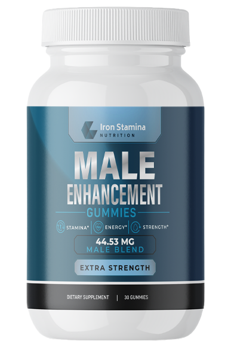

# Mastercard +1 Free Bottle Promo — Complete Step-by-Step Integration Guide

This guide is the complete, single-source-of-truth reference for integrating the **Mastercard +1 Free Bottle Upgrade Promotion** into **any offer or funnel**.

Every single line of code, template, configuration, and CRM setting is provided below in full — **no shortcuts, no placeholders, and no missing lines**.

---

## Table of Contents
1. [Offer Architecture & How It Works](#1-offer-architecture--how-it-works)
   - [Main Offer (Multi-Step) vs. DTC Offer (1-Step Combined)](#main-offer-multi-step-vs-dtc-offer-1-step-combined)
2. [Konnektive CRM Configuration](#2-konnektive-crm-configuration)
3. [The 5 Modular Files (Complete Code)](#3-the-5-modular-files-complete-code)
   - [3.1 `app/src/mc_banner.php`](#31-appsrcmc_bannerphp)
   - [3.2 `app/src/mc_modal.php`](#32-appsrcmc_modalphp)
   - [3.3 `assets/css/mc_promo.css`](#33-assetscssmc_promocss)
   - [3.4 `assets/js/mc_promo.js`](#34-assetsjsmc_promojs)
   - [3.5 `app/src/detect_card.php`](#35-appsrcdetect_cardphp)
4. [Backend Code Modifications](#4-backend-code-modifications)
   - [4.1 `app/configs/config.php`](#41-appconfigsconfigphp)
   - [4.2 `app/src/functions.php`](#42-appsrcfunctionsphp)
   - [4.3 `app/src/create_order.php` (Multi-Step & Mobile)](#43-appsrccreate_orderphp)
   - [4.4 `app/src/create-combined.php` (DTC 1-Step Checkout)](#44-appsrccreate-combinedphp-dtc-1-step-checkout)
   - [4.5 `app/src/fraud.php`](#45-appsrcfraudphp-luhn-check-bypass-for-test-cards)
5. [Frontend Integration: `payment.php` & `index.php` (Step-by-Step)](#5-frontend-integration-paymentphp-step-by-step)
   - [Step 5.1: Link Stylesheet in `<head>`](#step-51-link-stylesheet-in-head)
   - [Step 5.2: Enhance Product 1 (5-Bottle Plan) HTML](#step-52-enhance-product-1-5-bottle-plan-html)
   - [Step 5.3: Plug in Yellow Checkout Banner Above "We Accept:"](#step-53-plug-in-yellow-checkout-banner-above-we-accept)
   - [Step 5.4: Add Card Type Selector Above Card Number](#step-54-add-card-type-selector-above-card-number)
   - [Step 5.5: Update `submit_form()` JavaScript Validation](#step-55-update-submit_form-javascript-validation)
   - [Step 5.6: Include Modal & Script Before `</body>`](#step-56-include-modal--script-before-body)
   - [Step 5.7: DTC Lander Integration: `index.php`](#step-57-dtc-lander-integration-indexphp)
6. [Mobile Funnel Integration: `mobile/payment.php`](#6-mobile-funnel-integration-mobilepaymentphp)
7. [Comprehensive Testing & Verification Checklist](#7-comprehensive-testing--verification-checklist)
8. [Master AI Agent Prompt for Antigravity](#8-master-ai-agent-prompt-for-antigravity)

---

## 1. Offer Architecture & How It Works

### The Core Logic
- **Universal Multi-Bundle Support**: The promo system is completely modular and dynamically adapts to any bundle layout:
  - **2-Bottle / 3-Bottle / 5-Bottle Offers**: Package 5 (5 Bottles) upgrades to 6 Bottles (Product ID `195` — 3 paid + 3 free) at the exact same price ($198.80).
  - **2-Bottle / 4-Bottle / 6-Bottle Offers**: Package 6 (6 Bottles) upgrades to the Mastercard Promo Product (e.g. 7 Bottles or 6 Bottles discounted) at the exact same top-tier price.
- When a customer checks out using **Visa**:
  - They receive their standard selected package (e.g. 5 bottles or 6 bottles) at regular price.
- When a customer checks out using **Mastercard**:
  - They receive the top-tier package + 1 Free Bottle (or promo product) for the **exact same price**.
  - The effective cost per bottle drops, and total savings increase.
- Lower packages (2B, 3B, 4B) are **unaffected** when paid with Mastercard directly.

### Dynamic Promo Package (`promo_package`)
- Configured in `app/configs/config.php` via `'promo_package' => 5` (for 2B/3B/5B) or `'promo_package' => 6` (for 2B/4B/6B).
- Both frontend JavaScript and backend PHP automatically use this value to detect the active package, trigger the green banner, and upgrade lower packages to the promo tier upon clicking "Yes".

### How Price Deduction Works
- **The code never sends a manual price or custom dollar amount to Konnektive CRM.**
- In `create_order.php`, the server only sends the Konnektive Campaign Product ID (`product1_id`) and `campaignId`.
- Konnektive looks up the Campaign Product ID in its database and deducts the exact price configured on that product ($198.80).
- This prevents gateway tampering, avoids price mismatch errors, and complies with standard merchant gateway rules.

### Non-Restrictive Conversion Funnel & Universal Package Upgrade
- If a customer enters a Visa card (`4...`) or selects Visa from the dropdown on **ANY package** (Top Tier, Middle Tier, or Lower Tier), a tailored high-converting modal appears:
  - **On Top Tier (5B or 6B)**: Confirms +1 Extra Free Bottle at no extra charge ($198.80) when paying with Mastercard.
  - **On Lower / Middle Tiers (2B, 3B, 4B)**: Offers an instant upgrade to the Top Tier Package + 1 Free Bottle at $198.80 when switching to Mastercard.
  - **"YES, UPGRADE / ADD FREE BOTTLE WITH MASTERCARD"**: Automatically updates the package to the top promo package (which converts to the promo Product ID in Konnektive), updates price display, sets card type to Mastercard, activates the dark green promo banner, and clears the card input so they can enter their Mastercard.
  - **"No Thanks, continue with my [selected] card/plan"** (or click X / outside modal): Closes the modal. The user remains on their chosen package at their original price with Visa. **No card number or plan is ever forced or lost.**
  - **Direct Mastercard Checkout on Lower Tiers**: If a customer chooses a lower tier (2B, 3B, 4B) and pays with Mastercard directly, no popup interrupts them and they are billed for their chosen plan as normal.

### Card Switching & Single Source of Truth Security
- **Card Digits Single Source of Truth**: In `app/src/functions.php` and `create_order.php`, `is_mastercard()` strictly validates against the raw digits of `fields_cc_number`. If a card number begins with `4` (Visa), `3` (Amex), or `6` (Discover), `is_mastercard()` strictly returns `false`, ensuring Konnektive receives the standard 5-bottle package (`five_bottle_product_id`), **never** the promo product ID (`promo_product_id`)—even if the dropdown or POST payload says `master`.
- **Auto-Clear on Manual Dropdown Change**: In `assets/js/mc_promo.js`, when a customer manually changes `#card_type_select`, the `#cardNumber` input is **immediately cleared and focused** (`$(cfg.cardInputId).val('').focus()`), eliminating any card type vs. number mismatch.
- **Real-Time Keystroke Detection**: Switching cards in real time updates the UI instantly: entering Mastercard (`5...` or `2...`) attaches the promo (+1 Free Bottle, dark green banner) without popup interruption; backspacing and entering Visa (`4...`) instantly revokes the promo (yellow banner, 6th bottle hidden) without spamming repeat modals.
- **Configurable QA & Konnektive Test Cards Support**: Test cards can be configured directly in `config.php` under `'test_cards'` across three categories (`generic`, `visa`, and `master`). Konnektive requires custom test cards to start with `7` (e.g. `7411111111111111` for Visa, and `7555555555555444` for Mastercard). Both frontend `mc_promo.js` and server `is_mastercard()` automatically recognize configured test cards, whitelist them in `fraud.php` (bypassing Luhn validation), and route them to their proper brand flow (e.g., Mastercard promo flow vs. Visa modal trigger).

### Main Offer (Multi-Step) vs. DTC Offer (1-Step Combined)

When replicating the Mastercard Promo into an offer repository, identify whether the funnel is a **Main Offer** or a **DTC Offer**:

| Funnel Property | Main Offer (Multi-Step) | DTC Offer (1-Step Combined) |
| :--- | :--- | :--- |
| **User Flow** | Landing (`index.php`) ➔ VSL/Presell ➔ Shipping (`shipping.php`) ➔ Payment (`payment.php`) | Direct checkout lander (`index.php`) with bottle packages + shipping fields + credit card fields on 1 page |
| **Desktop Checkout File** | `payment.php` | **`index.php` AND `payment.php`** |
| **Order Processing Backend** | `app/src/create_order.php` | **`app/src/create-combined.php`** (Desktop)<br>`app/src/create_order.php` (Mobile) |
| **Subfolder Path Configuration** | Default domain or subfolder | Configured in `$productSubFolder = 'is-dtc-em/MCv1';` with normalized `$rootPath` / `$mobilePath` |

> [!CAUTION]
> **In DTC Offers, Desktop orders submit to `app/src/create-combined.php`!**
> If you only update `app/src/create_order.php`, orders submitted from `index.php` or `payment.php` will submit to `create-combined.php` without promo detection, resulting in Konnektive receiving standard Product ID `103` (5-Bottle Plan) instead of Product ID `195` (6-Bottle Promo Plan). Both files must be updated!

---

### 5B vs. 6B Funnel Architecture & Variable Conventions

In our funnel network, **5-Bottle and 6-Bottle funnels share the exact same files, directory structure, and checkout controllers**.

When an offer uses a 6-Bottle plan:
1. Instead of the 3-bottle product ID, you add the 4-bottle product ID.
2. Instead of the 5-bottle product ID, you add the 6-bottle product ID.
3. For the Mastercard promotion, you add the promo product ID (+1 Free Bottle / 6B promo).
4. **Variable names in `config.php` can stay identical** (`three_bottle_product_id`, `five_bottle_product_id`, `six_bottle_product_id`), or use descriptive names (`four_bottle_product_id`, `six_bottle_product_id`, `promo_product_id`).

#### Complete Variable Mapping Reference

| Tier / Package | 5-Bottle Plan (`promo_package = 5`) | 6-Bottle Plan: Variables Kept Same | 6-Bottle Plan: Descriptive Variables |
| :--- | :--- | :--- | :--- |
| **Top Tier (Standard)** | `five_bottle_product_id` (e.g. `103`) | `five_bottle_product_id` holds 6B ID (e.g. `4047`) | `six_bottle_product_id` (e.g. `4047`) |
| **Top Tier (Mastercard)** | `six_bottle_product_id` holds promo ID (`195`) | `six_bottle_product_id` holds promo ID (`4049`) | `promo_product_id` or `seven_bottle_product_id` (`4049`) |
| **Middle Tier** | `three_bottle_product_id` (e.g. `101`) | `three_bottle_product_id` holds 4B ID (e.g. `4045`) | `four_bottle_product_id` (e.g. `4045`) |
| **Lower Tier** | `two_bottle_product_id` (e.g. `99`) | `two_bottle_product_id` holds 2B ID (e.g. `4043`) | `two_bottle_product_id` or `one_bottle_product_id` (`4043`) |
| **Backend `promo_package`** | `5` | `6` | `6` |
| **HTML `data-pkg` attributes**| Top: `5`, Middle: `3`, Lower: `1` | Top: `6`, Middle: `4`, Lower: `2` | Top: `6`, Middle: `4`, Lower: `2` |

Both `app/src/create_order.php` and `app/src/create-combined.php` are coded with intelligent resolution logic so they seamlessly handle whichever variable convention is configured!

---

## 2. Konnektive CRM Configuration

Follow these exact steps inside your Konnektive CRM dashboard before deploying the code:

### Step 2.1: Add 6B Offer to Your Main Campaign (e.g. Campaign 25)
1. Navigate to **CRM > Campaigns > Edit Campaign** (e.g., *Iron Stamina Affiliate*).
2. Scroll to the **Offers** section and click **Options > Add Offer**:
   - **Product Type**: Select `Offer`.
   - **Display Name**: `IS - ME (S1) - 6B (Mastercard Promo)` (or your product name).
   - **Base Product**: Select your 6-bottle SKU (or 6x single bottle).
   - **Price**: `198.80` (exact same price as your 5-bottle plan).
   - **Ship Price**: `0.00` (Free shipping).
   - ⚠️ **Stand Alone Transaction**: **MUST BE OFF (Unchecked)**.
     - *Why?* If enabled, gateways treat secondary transactions as isolated and reject one-click upsells.
   - **Billing Schedule**:
     - *Billing Type*: `Recurring` (or `Standard` if non-recurring).
     - *Cycle 1*: Price `198.80`, Ship Price `0.00`, Shippable `Checked`.
     - *Cycle 2*: Price `198.80`, Bill Delay `30` (or `60` days according to rebill rules).
3. Click **Save**.
4. Note the newly generated **Campaign Product Id** (e.g., `195`).

### Step 2.2: Add 6B Offer to Your Scrub Campaign (e.g. Campaign 31)
1. Repeat the exact same setup under your Scrub Campaign (e.g., *Iron Stamina - SC*).
2. Click **Save** and note the **Scrub Campaign Product Id** (e.g., `197`).

---

## 3. The 5 Modular Files (Complete Code)

Copy each of the 5 files below into your project. These files are 100% modular and self-contained.

---

### 3.1 `app/src/mc_banner.php`
Create or update `app/src/mc_banner.php`:

```php
<?php
/**
 * Mastercard Checkout Promo Banner Partial (S Offer Style)
 * Modular, customizable, and easy to drop into any checkout lander right above the payment form.
 */
$mcPromo = (isset($configs) && isset($configs->mc_promo)) ? $configs->mc_promo : (object) array();

$bannerLogo     = $mcPromo->banner_logo_img ?? 'assets/images/mastercard.png';
$bannerPill     = $mcPromo->banner_pill ?? 'LIMITED OFFER:';
$bannerHeadline = $mcPromo->banner_headline ?? 'Receive an Additional bottle for FREE when paying with Mastercard!';
$bannerApplied  = $mcPromo->banner_applied_text ?? '🎉 LIMITED OFFER APPLIED: +1 Free Bottle Added with Mastercard!';

$rootPath = (isset($configs) && isset($configs->root_path)) ? $configs->root_path : '';
$resolvedLogo = $bannerLogo;
if (!empty($bannerLogo) && strpos($bannerLogo, 'http') !== 0 && strpos($bannerLogo, '/') !== 0 && !empty($rootPath)) {
    $resolvedLogo = rtrim($rootPath, '/') . '/' . ltrim($bannerLogo, '/');
}
?>
<!-- Mastercard Special Offer Banner -->
<div class="mastercard-checkout-banner yellow-offer-box" id="mastercardCheckoutBanner">
    <div class="mc-banner-default-view" id="mcBannerDefault">
        <?php if (!empty($resolvedLogo)): ?>
            <div class="mc-banner-logo-wrap">
                " alt="Mastercard" class="mc-banner-logo-img">
            </div>
        <?php endif; ?>
        <span class="mc-banner-pill-red" id="mcBannerPill"><?= htmlspecialchars($bannerPill); ?></span>
        <span class="mc-banner-heading-text" id="mcBannerHeading"><?= htmlspecialchars($bannerHeadline); ?></span>
    </div>
    <div class="mc-banner-applied-view" id="mcBannerApplied" style="display: none;">
        <span class="mc-banner-applied-text" id="mcBannerAppliedText"><?= htmlspecialchars($bannerApplied); ?></span>
    </div>
</div>
<script>
window.MCPromoConfig = window.MCPromoConfig || {};
window.MCPromoConfig.bannerLogo = <?= json_encode($resolvedLogo); ?>;
window.MCPromoConfig.bannerPill = <?= json_encode($bannerPill); ?>;
window.MCPromoConfig.bannerHeadline = <?= json_encode($bannerHeadline); ?>;
window.MCPromoConfig.bannerAppliedText = <?= json_encode($bannerApplied); ?>;
</script>
```

---

### 3.2 `app/src/mc_modal.php`
Create or update `app/src/mc_modal.php`:

```php
<?php
/**
 * Mastercard +1 Free Bottle Upgrade Modal Partial (S Offer Popup Design)
 * Modular, customizable, and reads directly from $configs->mc_promo.
 */
$mcPromo = (isset($configs) && isset($configs->mc_promo)) ? $configs->mc_promo : (object) array();

// Extract per-package configurations
$packagesConfig = array();
if (!empty($mcPromo->packages)) {
    foreach ($mcPromo->packages as $pkgKey => $pkgVal) {
        $packagesConfig[$pkgKey] = (array) $pkgVal;
    }
}

// Current active package (default to promo_package, e.g. 5 or 6)
$promoPackage   = $mcPromo->promo_package ?? 5;
$activePackage  = $_SESSION['package'] ?? $_REQUEST['pk'] ?? $promoPackage;
$currentPkgData = $packagesConfig[$activePackage] ?? ($packagesConfig[$promoPackage] ?? (reset($packagesConfig) ?: array()));

$topTitle      = $currentPkgData['top_title'] ?? $mcPromo->modal_top_title ?? 'SPECIAL MASTERCARD UPGRADE <br>1 FREE BOTTLE!';
$headline      = $currentPkgData['headline'] ?? $mcPromo->modal_headline ?? 'Upgrade your Package to <strong>5-Bottle Package & get 1 FREE Bottle</strong> when you pay with Mastercard.';
$subtext       = $currentPkgData['subtext'] ?? '';
$logoImg       = $mcPromo->modal_logo_img ?? 'assets/images/mastercard.png';
$btnYesText    = $currentPkgData['btn_yes'] ?? $mcPromo->modal_btn_yes ?? '✓ Yes, I want to receive a FREE Bottle with my MasterCard';
$btnNoText     = $currentPkgData['btn_no'] ?? $mcPromo->modal_btn_no ?? 'No Thanks, continue with my Visa card';
$securityNote  = $mcPromo->modal_security_text ?? '🔒 Safe &amp; Secure 256-Bit Encrypted Checkout';

$rootPath = (isset($configs) && isset($configs->root_path)) ? $configs->root_path : '';
$resolvedModalLogo = $logoImg;
if (!empty($logoImg) && strpos($logoImg, 'http') !== 0 && strpos($logoImg, '/') !== 0 && !empty($rootPath)) {
    $resolvedModalLogo = rtrim($rootPath, '/') . '/' . ltrim($logoImg, '/');
}
?>
<!-- Visa Offer Modal: Mastercard +1 Free Bottle Upgrade (S Offer Style) -->
<div class="mc-modal-backdrop" id="mcVisaOfferModal" style="display: none;">
    <div class="mc-modal-box s-offer-modal">
        <button type="button" class="mc-modal-x" id="mcModalXBtn" aria-label="Close">&times;</button>
        <div class="mc-modal-inner">
            <!-- Top Title (HTML Supported) -->
            <h3 class="mc-modal-top-title" id="mcModalTopTitle"><?= $topTitle; ?></h3>
            <hr class="mc-modal-divider">

            <!-- Bold Headline (HTML Supported) -->
            <p class="mc-modal-bold-headline" id="mcModalHeadline">
                <?= $headline; ?>
            </p>

            <!-- Subtext / Details for package upgrade (HTML Supported) -->
            <p class="mc-modal-subtext" id="mcModalSubText" <?= empty($subtext) ? 'style="display:none;"' : ''; ?>>
                <?= $subtext; ?>
            </p>

            <!-- Mastercard Logo -->
            <div class="mc-modal-logo-area">
                " alt="Mastercard" class="mc-modal-logo-img">
            </div>

            <!-- Action Buttons (HTML Supported) -->
            <div class="mc-modal-actions-container">
                <button type="button" class="btn-mc-confirm-yes" id="btnMcYes">
                    <span id="mcModalBtnYesText"><?= $btnYesText; ?></span>
                </button>
                <button type="button" class="btn-mc-decline-no" id="btnMcNo">
                    <span id="mcModalBtnNoText"><?= $btnNoText; ?></span>
                </button>
            </div>

            <div class="mc-modal-security-note">
                <?= $securityNote; ?>
            </div>
        </div>
    </div>
</div>

<script type="text/javascript">
window.MCPromoConfig = window.MCPromoConfig || {};
window.MCPromoConfig.promoPackage = <?= json_encode($mcPromo->promo_package ?? 5); ?>;
window.MCPromoConfig.promoPrice = <?= json_encode((string)($mcPromo->promo_price ?? '198.80')); ?>;
window.MCPromoConfig.packages = <?= json_encode($packagesConfig, JSON_HEX_TAG | JSON_HEX_APOS | JSON_HEX_QUOT | JSON_HEX_AMP); ?>;
window.MCPromoConfig.testCards = <?= json_encode($mcPromo->test_cards ?? (object) array(
    'generic' => array('0000', '0000000000000000'),
    'visa'    => array('7411111111111111'),
    'master'  => array('7555555555555444'),
)); ?>;
</script>
```

---

### 3.3 `assets/css/mc_promo.css`
Create or update `assets/css/mc_promo.css`:

```css
/* ==========================================================================
   Mastercard Promo & Upgrade Modal Stylesheet (S Offer Style)
   Modular, responsive & drop-in ready for any offer checkout.
   ========================================================================== */

/* 1. Checkout Banner (S Offer Yellow Box Style) */
.mastercard-checkout-banner.yellow-offer-box {
    margin: 14px 15px 12px 15px;
    background: #ffff00;
    background: linear-gradient(180deg, #ffff00 0%, #fff700 100%);
    border: 1.5px solid #d4ac00;
    border-radius: 6px;
    padding: 12px 14px;
    box-sizing: border-box;
    box-shadow: 0 3px 8px rgba(0, 0, 0, 0.16);
    transition: all 0.3s ease;
    text-align: center;
    position: relative;
    overflow: hidden;
}

/* 1b. Single Solid Dark Green Box when Promo is Active */
.mastercard-checkout-banner.yellow-offer-box.promo-applied {
    background: #15803d;
    background: linear-gradient(180deg, #16a34a 0%, #15803d 100%);
    border: 1.5px solid #14532d;
    border-radius: 6px;
    box-shadow: 0 4px 12px rgba(21, 128, 61, 0.4);
    padding: 13px 14px;
}

.mc-banner-default-view {
    display: block;
    text-align: center;
    line-height: 1.35;
}

.mc-banner-logo-wrap {
    text-align: center;
    margin: 0 0 6px 0;
    line-height: 1;
}

.mc-banner-logo-img {
    height: 28px;
    width: auto;
    object-fit: contain;
    border-radius: 4px;
    display: inline-block;
    box-shadow: 0 2px 5px rgba(0, 0, 0, 0.18);
}

.mc-banner-applied-view {
    display: block;
    text-align: center;
    line-height: 1.35;
}

.mc-banner-pill-red {
    color: #e50000;
    font-family: 'Poppins', 'Roboto', -apple-system, BlinkMacSystemFont, sans-serif;
    font-size: 15px;
    font-weight: 900;
    letter-spacing: 0.3px;
    display: inline;
    margin-right: 5px;
    text-transform: uppercase;
}

.mc-banner-heading-text {
    color: #111111;
    font-family: 'Poppins', 'Roboto', -apple-system, BlinkMacSystemFont, sans-serif;
    font-size: 15px;
    font-weight: 700;
    line-height: 1.35;
    display: inline;
}

.mc-banner-applied-text {
    color: #ffffff;
    font-family: 'Poppins', 'Roboto', -apple-system, BlinkMacSystemFont, sans-serif;
    font-size: 14px;
    font-weight: 800;
    line-height: 1.35;
    letter-spacing: 0.4px;
    text-transform: uppercase;
    display: inline-block;
    text-shadow: 0 1px 2px rgba(0, 0, 0, 0.25);
}

/* 2. We Accept Cards List */
.accept-text {
    display: block;
    text-align: center;
    padding: 10px 15px 4px !important;
}

.form__cards {
    text-align: center;
    margin: 0 0 10px 0;
    padding: 0;
}

.form__cards li {
    display: inline-block;
    padding: 0 4px;
    margin: 0 2px;
    border: none !important;
    box-shadow: none !important;
    background: transparent !important;
    outline: none !important;
}

.form__cards li img {
    height: 33px;
    width: auto;
    border: none !important;
    box-shadow: none !important;
    outline: none !important;
}

/* 3. Card Type Dropdown Selector */
#card_type_select {
    background-color: #fff;
    border: 1px solid #989898;
    box-shadow: inset 0 1px 2px rgba(0, 0, 0, 0.4);
    color: rgba(0, 0, 0, 0.75);
    font-size: 1rem;
    margin: 0 0 1rem !important;
    padding: 0 0.5rem;
    height: 2.4375rem;
    line-height: 2.4375rem;
    width: 100%;
    box-sizing: border-box;
    border-radius: 0;
    vertical-align: middle;
}

/* Mobile specific styling for Card Type Dropdown Selector */
body[data-mobile-id] #card_type_select,
.checkout-page #card_type_select,
.checkout-form-wrapper #card_type_select {
    -webkit-appearance: none;
    -moz-appearance: none;
    appearance: none;
    background-color: #ffffff;
    background-image: url("data:image/svg+xml;charset=US-ASCII,%3Csvg%20xmlns%3D%22http%3A%2F%2Fwww.w3.org%2F2000%2Fsvg%22%20width%3D%2212%22%20height%3D%228%22%20viewBox%3D%220%200%2012%208%22%3E%3Cpath%20fill%3D%22%23333333%22%20d%3D%22M1.41%200L6%204.58%2010.59%200%2012%201.41l-6%206-6-6z%22%2F%3E%3C%2Fsvg%3E");
    background-repeat: no-repeat;
    background-position: right 14px center;
    background-size: 12px 8px;
    border: 1px solid #000000;
    -webkit-border-radius: 5px;
    -moz-border-radius: 5px;
    border-radius: 5px;
    box-shadow: none;
    color: #111111;
    display: block;
    font-size: 17px;
    font-family: inherit;
    height: 40px;
    line-height: 38px;
    margin: 0 0 10px 0 !important;
    padding: 0 32px 0 8px;
    width: 100%;
    -webkit-box-sizing: border-box;
    -moz-box-sizing: border-box;
    box-sizing: border-box;
    vertical-align: middle;
}

/* 5. Product Plan 1 Promo Elements & 6th Bottle Layering */
.mc-hdr-tag {
    background: #16a34a;
    color: #fff;
    font-size: 11px;
    font-weight: 800;
    padding: 2px 6px;
    border-radius: 4px;
    margin-left: 6px;
    vertical-align: middle;
    display: inline-block;
}

.mc-pack-sub {
    display: block;
    color: #16a34a;
    font-size: 12px;
    font-weight: 700;
    margin-top: 3px;
    font-style: normal;
}

/* 6th Bottle Styling & Second Group Layering:
   - 4th bottle on left: left: 25px, z-index: 1 (on back)
   - 5th bottle (middle bottle): z-index: 3 (on top)
   - 6th bottle on right: right: 25px, z-index: 1 (on back)
*/
.product1-image4 {
    left: 25px;
    z-index: 1;
}

.product1-image5 {
    z-index: 3;
}

.product1-image6 {
    right: 25px;
    z-index: 1;
    display: none;
}

.product1.mc-6b-active .product1-image4 {
    left: 25px;
    z-index: 1;
}

.product1.mc-6b-active .product1-image5 {
    z-index: 3;
    left: auto;
    right: auto;
}

.product1.mc-6b-active .product1-image6 {
    right: 25px;
    z-index: 1;
    display: block !important;
}

/* 6. Visa Popup Modal (S Offer Style) */
.mc-modal-backdrop {
    position: fixed;
    top: 0;
    left: 0;
    width: 100vw;
    height: 100vh;
    background: rgba(15, 23, 42, 0.75);
    backdrop-filter: blur(4px);
    -webkit-backdrop-filter: blur(4px);
    z-index: 9999999;
    display: flex;
    align-items: center;
    justify-content: center;
    padding: 16px;
    box-sizing: border-box;
}

.mc-modal-box.s-offer-modal {
    background: #ffffff;
    max-width: 490px;
    width: 100%;
    border-radius: 10px;
    overflow: hidden;
    position: relative;
    border: 1px solid #dcdcdc;
    box-shadow: 0 20px 50px rgba(0, 0, 0, 0.35);
    animation: mcPopZoom 0.32s cubic-bezier(0.16, 1, 0.3, 1);
}

.mc-modal-x {
    position: absolute;
    top: 12px;
    right: 12px;
    background: #f1f5f9;
    border: none;
    border-radius: 50%;
    width: 30px;
    height: 30px;
    font-size: 18px;
    line-height: 30px;
    color: #64748b;
    cursor: pointer;
    text-align: center;
    padding: 0;
    transition: all 0.2s;
    z-index: 10;
}

.mc-modal-x:hover {
    background: #e2e8f0;
    color: #0f172a;
}

.mc-modal-inner {
    padding: 24px 28px 24px;
    text-align: center;
}

.mc-modal-top-title {
    color: #1a9e3f;
    font-family: 'Poppins', 'Oswald', -apple-system, BlinkMacSystemFont, sans-serif;
    font-size: 20px;
    font-weight: 800;
    text-transform: uppercase;
    letter-spacing: 0.5px;
    text-align: center;
    margin: 0 0 12px 0;
    line-height: 1.25;
}

.mc-modal-divider {
    border: 0;
    border-top: 1px solid #e5e7eb;
    margin: 0 0 16px 0;
}

.mc-modal-bold-headline {
    font-family: 'Poppins', -apple-system, BlinkMacSystemFont, sans-serif;
    font-size: 17px;
    font-weight: 800;
    color: #111827;
    text-align: center;
    line-height: 1.45;
    margin: 0 0 12px 0;
}

.mc-modal-subtext {
    font-family: 'Poppins', -apple-system, BlinkMacSystemFont, sans-serif;
    font-size: 14px;
    font-weight: 500;
    color: #374151;
    text-align: center;
    line-height: 1.45;
    margin: 0 0 14px 0;
    padding: 0 6px;
}

.mc-modal-subtext strong {
    color: #15803d;
    font-weight: 700;
}

.mc-modal-logo-area {
    margin: 8px 0 18px 0;
    text-align: center;
}

.mc-modal-logo-img {
    height: 48px;
    width: auto;
    max-width: 100%;
    display: inline-block;
    filter: drop-shadow(0 2px 5px rgba(0, 0, 0, 0.12));
}

.mc-modal-actions-container {
    display: flex;
    flex-direction: column;
    gap: 8px;
    align-items: center;
}

.btn-mc-confirm-yes {
    background: #22a745;
    background: linear-gradient(180deg, #28a745 0%, #218838 100%);
    color: #ffffff;
    font-family: 'Poppins', 'Oswald', -apple-system, BlinkMacSystemFont, sans-serif;
    font-size: 17px;
    font-weight: 700;
    padding: 15px 20px;
    border: none;
    border-radius: 6px;
    cursor: pointer;
    text-align: center;
    width: 100%;
    box-shadow: 0 4px 14px rgba(40, 167, 69, 0.38);
    transition: all 0.2s ease;
    display: block;
    box-sizing: border-box;
}

.btn-mc-confirm-yes:hover {
    background: linear-gradient(180deg, #218838 0%, #1e7e34 100%);
    transform: translateY(-1px);
    box-shadow: 0 6px 18px rgba(40, 167, 69, 0.48);
}

.btn-mc-decline-no {
    background: transparent;
    color: #6b7280;
    font-size: 13px;
    font-weight: 500;
    border: none;
    padding: 6px;
    cursor: pointer;
    text-decoration: underline;
    transition: color 0.2s;
    margin-top: 6px;
}

.btn-mc-decline-no:hover {
    color: #111827;
}

.mc-modal-security-note {
    margin-top: 14px;
    font-size: 11px;
    color: #94a3b8;
    display: flex;
    align-items: center;
    justify-content: center;
}

/* 7. Keyframe Animations */
@keyframes mcPopZoom {
    0% { opacity: 0; transform: scale(0.92) translateY(15px); }
    100% { opacity: 1; transform: scale(1) translateY(0); }
}

@keyframes mcFadeSlide {
    0% { opacity: 0; transform: translateY(-6px); }
    100% { opacity: 1; transform: translateY(0); }
}

@keyframes mcBottleFloat {
    0% { transform: translateY(0); filter: drop-shadow(0 2px 6px rgba(22, 163, 74, 0.4)); }
    100% { transform: translateY(-4px); filter: drop-shadow(0 6px 14px rgba(22, 163, 74, 0.8)); }
}

@keyframes mcPulseGlow {
    0% { box-shadow: 0 2px 6px rgba(22, 163, 74, 0.3); }
    100% { box-shadow: 0 4px 14px rgba(22, 163, 74, 0.7); }
}
```

---

### 3.4 `assets/js/mc_promo.js`
Create or update `assets/js/mc_promo.js`:

```javascript
/**
 * ==========================================================================
 * Mastercard Promo & Free Bottle Upgrade Module
 * Handles card detection, Visa modal offer, price updates & synchronization.
 * Plug & play across any checkout lander.
 * ==========================================================================
 */

(function($) {
    'use strict';

    // Configurable options with sensible defaults (supports runtime window.MCPromoConfig)
    var userCfg = window.MCPromoConfig || {};
    var cfg = {
        modalId: userCfg.modalId || '#mcVisaOfferModal',
        cardInputId: userCfg.cardInputId || '#cardNumber',
        cardSelectId: userCfg.cardSelectId || '#card_type_select',
        bannerId: userCfg.bannerId || '#mastercardCheckoutBanner',
        detectEndpoint: userCfg.detectEndpoint || (window.location.pathname.indexOf('/mobile/') !== -1 ? '../app/src/detect_card.php' : 'app/src/detect_card.php'),
        bannerPill: userCfg.bannerPill || 'LIMITED OFFER:',
        bannerHeadline: userCfg.bannerHeadline || 'Receive an Additional bottle for FREE when paying with Mastercard!',
        bannerAppliedText: userCfg.bannerAppliedText || '+1 FREE BOTTLE ADDED WITH MASTERCARD!',
        promoPackage: userCfg.promoPackage || 5,
        promoPrice: userCfg.promoPrice || '198.80',
        packages: userCfg.packages || {},
        p1: $.extend({
            headerTitle: '#p1-header-title',
            bottle6: '#product1-image6',
            productBox: '.product1',
            packTitle: '#p1-pack-title',
            perPrice: '#p1-per-price',
            savePrice: '#p1-save-price',
            retailPrice: '#p1-retail-price',
            textNormal: 'BUY 3 GET 2 FREE',
            textPromo: 'BUY 3 GET 3 FREE (+1 BONUS)',
            packNormal: '5 Bottle Performance Pack',
            packPromo: '6 Bottle Performance Pack <em class="mc-pack-sub">(Includes +1 FREE Bottle!)</em>',
            perNormal: '39.76',
            perPromo: '33.13',
            saveNormal: '151.15',
            savePromo: '221.14',
            retailNormal: '349.95',
            retailPromo: '419.94'
        }, userCfg.p1 || {})
    };

    var currentCardType = '';
    var visaPopupShown = false;
    var ajaxDetectTimer = null;

    function attachFreeBottle() {
        // Promo applies to Plan 1 (5 Bottle Pack upgraded to 6 Bottles)
        $(cfg.p1.headerTitle).text(cfg.p1.textPromo);
        $(cfg.p1.productBox).addClass('mc-6b-active');
        $(cfg.p1.bottle6).show();
        $(cfg.p1.packTitle).html(cfg.p1.packPromo);

        // Update pricing displays if present
        if ($(cfg.p1.perPrice).length) {
            $(cfg.p1.perPrice).text(cfg.p1.perPromo);
        }
        if ($(cfg.p1.savePrice).length) {
            $(cfg.p1.savePrice).text(cfg.p1.savePromo);
        }
        if ($(cfg.p1.retailPrice).length) {
            $(cfg.p1.retailPrice).text(cfg.p1.retailPromo);
        }

        // Single dark green banner update
        $(cfg.bannerId).addClass('promo-applied');
        $('#mcBannerDefault').hide();
        $('#mcBannerApplied').show();
        if ($('#mcBannerAppliedText').length && cfg.bannerAppliedText) {
            $('#mcBannerAppliedText').text(cfg.bannerAppliedText);
        }

        // Notify server session
        $.ajax({
            type: 'POST',
            url: cfg.detectEndpoint,
            dataType: 'json',
            data: { action: 'set_mastercard_promo' }
        });
    }

    function detachFreeBottle() {
        // Revert Plan 1
        $(cfg.p1.headerTitle).text(cfg.p1.textNormal);
        $(cfg.p1.productBox).removeClass('mc-6b-active');
        $(cfg.p1.bottle6).hide();
        $(cfg.p1.packTitle).text(cfg.p1.packNormal);

        // Revert pricing displays
        if ($(cfg.p1.perPrice).length) {
            $(cfg.p1.perPrice).text(cfg.p1.perNormal);
        }
        if ($(cfg.p1.savePrice).length) {
            $(cfg.p1.savePrice).text(cfg.p1.saveNormal);
        }
        if ($(cfg.p1.retailPrice).length) {
            $(cfg.p1.retailPrice).text(cfg.p1.retailNormal);
        }

        // Revert Banner (Back to yellow box)
        $(cfg.bannerId).removeClass('promo-applied');
        $('#mcBannerApplied').hide();
        $('#mcBannerDefault').show();

        // Notify server session
        $.ajax({
            type: 'POST',
            url: cfg.detectEndpoint,
            dataType: 'json',
            data: { action: 'cancel_promo' }
        });
    }

    function getPromoPkg() {
        return parseInt(cfg.promoPackage || (window.MCPromoConfig && window.MCPromoConfig.promoPackage) || 5);
    }

    function getActivePkg() {
        var promoPkg = getPromoPkg();
        var val = $('input[name=package]').val() || $('#package').val();
        return val ? parseInt(val) : promoPkg;
    }

    function updatePromoState() {
        var isMobile = (window.location.pathname.indexOf('/mobile/') !== -1);
        var promoPkg = getPromoPkg();
        var activePkg = getActivePkg();

        if (isMobile) {
            if (currentCardType === 'master' && activePkg === promoPkg) {
                attachFreeBottle();
            } else {
                detachFreeBottle();
            }
        } else {
            if (currentCardType === 'master') {
                attachFreeBottle();
            } else {
                detachFreeBottle();
            }
        }
    }

    function setCardType(type, fromUserDropdown) {
        currentCardType = type;
        if (!fromUserDropdown) {
            $(cfg.cardSelectId).val(type);
        }
        $('input[name=fields_cc_type]').val(type);
        $('#cc_type').val(type);

        updatePromoState();
    }

    function renderModalContent(pkg) {
        var promoPkg = getPromoPkg();
        var activePkg = parseInt(pkg !== undefined ? pkg : getActivePkg());
        var packagesCfg = (window.MCPromoConfig && window.MCPromoConfig.packages) ? window.MCPromoConfig.packages : (cfg.packages || {});
        var pkgData = packagesCfg[activePkg] || null;

        var topTitle = (pkgData && pkgData.top_title) ? pkgData.top_title : 'SPECIAL MASTERCARD UPGRADE <br>1 FREE BOTTLE!';
        var headline = (pkgData && pkgData.headline) ? pkgData.headline : 'Upgrade your Package to <strong>5-Bottle Package & get 1 FREE Bottle</strong> when you pay with Mastercard.';
        var subtext = (pkgData && pkgData.subtext !== undefined) ? pkgData.subtext : '';
        var btnYes = (pkgData && pkgData.btn_yes) ? pkgData.btn_yes : '✓ Yes, I want to receive a FREE Bottle with my MasterCard';
        var btnNo = (pkgData && pkgData.btn_no) ? pkgData.btn_no : 'No Thanks, continue with my Visa card';

        // Fallback defaults if no packages config provided for this package
        if (!pkgData) {
            if (activePkg === promoPkg) {
                topTitle = 'SPECIAL MASTERCARD UPGRADE <br>1 FREE BOTTLE!';
                headline = 'Get 6 Bottles for Only <span style="color:#16a34a; font-weight:800;">$33.13 / bottle</span>';
                subtext = 'Pay with Mastercard to get <strong>+1 EXTRA FREE Bottle</strong> added to your 5-Bottle package (Total 6 Bottles) at no extra charge!';
                btnYes = '✓ Yes, Add +1 FREE Bottle with my Mastercard';
                btnNo = 'No Thanks, continue with my Visa card';
            } else {
                topTitle = 'SPECIAL MASTERCARD UPGRADE <br>1 FREE BOTTLE!';
                headline = 'Get 6 Bottles for Only <span style="color:#16a34a; font-weight:800;">$33.13 / bottle</span>';
                subtext = 'Upgrade your Package to <strong>5-Bottle Package & get 1 FREE Bottle</strong> when you pay with Mastercard.';
                btnYes = '✓ Yes, Upgrade to 6 Bottles with Mastercard';
                btnNo = 'No Thanks, keep my Package with Visa';
            }
        }

        if ($('#mcModalTopTitle').length) {
            $('#mcModalTopTitle').html(topTitle);
        }
        if ($('#mcModalHeadline').length) {
            $('#mcModalHeadline').html(headline);
        }
        if ($('#mcModalSubText').length) {
            if (subtext) {
                $('#mcModalSubText').html(subtext).show();
            } else {
                $('#mcModalSubText').hide();
            }
        }
        if ($('#mcModalBtnYesText').length) {
            $('#mcModalBtnYesText').html(btnYes);
        }
        if ($('#mcModalBtnNoText').length) {
            $('#mcModalBtnNoText').html(btnNo);
        }
    }

    function openVisaOfferModal(pkg) {
        if (visaPopupShown) return;
        visaPopupShown = true;
        renderModalContent(pkg);
        $(cfg.modalId).fadeIn(200);
    }

    // Dropdown change listener
    $(document).on('change', cfg.cardSelectId, function() {
        var val = $(this).val();

        // Clear card input field whenever user manually changes card type to ensure consistency
        $(cfg.cardInputId).val('').focus();

        if (val === 'visa') {
            setCardType('visa', true);
            var activePkg = getActivePkg();
            openVisaOfferModal(activePkg);
        } else if (val === 'master') {
            setCardType('master', true);
        } else {
            setCardType('', true);
        }
    });

    // Package change listener - trigger Visa upgrade popup if user switches packages while Visa is selected
    $(document).on('click', '.product-selection > .product, [data-pkg]', function() {
        setTimeout(function() {
            var activePkg = getActivePkg();
            if (currentCardType === 'visa' && !visaPopupShown) {
                openVisaOfferModal(activePkg);
            }
        }, 15);
    });

    // Modal Action: User accepts Mastercard offer
    $(document).on('click', '#btnMcYes', function() {
        $(cfg.modalId).fadeOut(200);

        var promoPkg = getPromoPkg();
        var promoPrice = (cfg.promoPrice || (window.MCPromoConfig && window.MCPromoConfig.promoPrice) || '198.80');
        var activePkg = getActivePkg();

        // If user was on a lower tier, automatically upgrade their package to promoPkg
        if (activePkg !== promoPkg) {
            if ($('[data-pkg="' + promoPkg + '"]').length) {
                $('[data-pkg="' + promoPkg + '"]').trigger('click');
            } else if ($('.product1').length) {
                // Desktop: click package 1 (.product1) to update UI & active states
                $('.product1').trigger('click');
            }
            // Ensure hidden inputs across mobile and desktop are updated
            $('input[name=package]').val(promoPkg);
            $('#package').val(promoPkg);
            if ($('#amount').length) {
                $('#amount').val(promoPrice);
            }
        }

        setCardType('master', false);
        attachFreeBottle();
        $(cfg.cardInputId).val('').focus();
    });

    // Modal Action: User declines Mastercard offer
    function dismissVisaModal() {
        $(cfg.modalId).fadeOut(200);
        setCardType('visa', false);
        $(cfg.cardInputId).focus();
    }

    $(document).on('click', '#btnMcNo, #mcModalXBtn', dismissVisaModal);

    $(document).on('click', cfg.modalId, function(e) {
        if ($(e.target).is(cfg.modalId)) {
            dismissVisaModal();
        }
    });

    // Card number input monitoring & automatic detection
    function handleCardNumberChange() {
        var rawVal = $(cfg.cardInputId).val() || '';
        var cleanNum = rawVal.replace(/\D/g, '');

        if (cleanNum.length === 0) {
            var selectedType = $(cfg.cardSelectId).val() || '';
            if (selectedType !== 'master') {
                setCardType(selectedType, false);
            }
            return;
        }

        var activePkg = getActivePkg();

        // Check configurable test card arrays
        var tc = (window.MCPromoConfig && window.MCPromoConfig.testCards) ? window.MCPromoConfig.testCards : (cfg.testCards || {});
        var genericList = (tc.generic && Array.isArray(tc.generic)) ? tc.generic : ['0000'];
        var visaList = (tc.visa && Array.isArray(tc.visa)) ? tc.visa : ['7411111111111111'];
        var masterList = (tc.master && Array.isArray(tc.master)) ? tc.master : ['7555555555555444'];

        function isCardMatch(num, list) {
            if (!num || !list || !list.length) return false;
            for (var i = 0; i < list.length; i++) {
                var item = String(list[i]).replace(/\D/g, '');
                if (item && (num === item || num.indexOf(item) === 0)) {
                    return true;
                }
            }
            return false;
        }

        // 1. Whitelisted Generic Test Card (e.g. 0000...): follows manual dropdown selection
        if (isCardMatch(cleanNum, genericList)) {
            var selectedType = $(cfg.cardSelectId).val() || '';
            setCardType(selectedType, false);
            return;
        }

        // 2. Whitelisted Visa Test Card: acts as Visa
        if (isCardMatch(cleanNum, visaList)) {
            setCardType('visa', false);
            openVisaOfferModal(activePkg);
            return;
        }

        // 3. Whitelisted Mastercard Test Card: acts as Mastercard
        if (isCardMatch(cleanNum, masterList)) {
            setCardType('master', false);
            return;
        }

        // Support Konnektive test cards prefixed with '7' (e.g. 74... for Visa, 75... for Mastercard)
        var testNum = cleanNum;
        if (cleanNum.charAt(0) === '7' && cleanNum.length > 1) {
            testNum = cleanNum.substring(1);
        }

        var firstChar = testNum.charAt(0);

        // 4. Visa: starts with 4 (or Konnektive test card 74...)
        if (firstChar === '4') {
            setCardType('visa', false);
            openVisaOfferModal(activePkg);
            return;
        }

        // 5. Mastercard: starts with 5 or 2 (or Konnektive test card 75... / 72...)
        if (firstChar === '5' || firstChar === '2') {
            setCardType('master', false);
            return;
        }

        // 6. Amex (starts with 3) or Discover (starts with 6) -> immediately revoke promo
        if (firstChar === '3' || firstChar === '6') {
            setCardType(firstChar === '3' ? 'amex' : 'discover', false);
            return;
        }

        // 7. Generic test card (0000...): follows the dropdown
        if (cleanNum.indexOf('0000') === 0) {
            var selectedType = $(cfg.cardSelectId).val() || '';
            setCardType(selectedType, false);
            return;
        }

        // 8. Fallback Ajax detection
        clearTimeout(ajaxDetectTimer);
        ajaxDetectTimer = setTimeout(function() {
            $.ajax({
                type: 'POST',
                url: cfg.detectEndpoint,
                dataType: 'json',
                data: { action: 'detect', card_number: cleanNum },
                success: function(resp) {
                    if (!resp || resp.status !== 'success') return;
                    if (resp.is_mastercard) {
                        setCardType('master', false);
                    } else if (resp.is_visa) {
                        setCardType('visa', false);
                        var pkgNow = getActivePkg();
                        openVisaOfferModal(pkgNow);
                    } else {
                        setCardType(resp.card_type || '', false);
                    }
                }
            });
        }, 120);
    }

    $(document).on('input keyup paste change', cfg.cardInputId, handleCardNumberChange);

    // Auto-initialize on DOM ready if card type is already selected (e.g. page refresh / back navigation)
    $(function() {
        var initialType = $(cfg.cardSelectId).val();
        if (initialType) {
            setCardType(initialType, true);
        }
    });

    // Expose helpers globally
    window.setCardType = setCardType;
    window.MCPromo = {
        setCardType: setCardType,
        attachFreeBottle: attachFreeBottle,
        detachFreeBottle: detachFreeBottle,
        dismissVisaModal: dismissVisaModal
    };

})(jQuery);
```

---

### 3.5 `app/src/detect_card.php`
Create or update `app/src/detect_card.php`:

```php
<?php
include(__DIR__ . '/../../_global.php');

header('Content-Type: application/json');

$action = $_POST['action'] ?? 'detect';
$rawCard = $_POST['card_number'] ?? '';
$cleanCard = preg_replace('/\D/', '', $rawCard);

if ($action === 'set_mastercard_promo') {
    $_SESSION['mastercard_promo'] = true;
    $_SESSION['card_type_locked'] = 'master';
    echo json_encode([
        'status' => 'success',
        'promo_active' => true,
        'free_bottle' => true,
        'locked_card_type' => 'master',
        'message' => 'Mastercard promo activated! Extra free bottle attached.'
    ]);
    exit();
}

if ($action === 'cancel_promo') {
    $_SESSION['mastercard_promo'] = false;
    unset($_SESSION['card_type_locked']);
    echo json_encode([
        'status' => 'success',
        'promo_active' => false,
        'free_bottle' => false,
        'message' => 'Mastercard promo cancelled.'
    ]);
    exit();
}

// Detection logic
$isMastercard = false;
$isVisa = false;
$cardType = 'unknown';

if (strlen($cleanCard) > 0) {
    // 1. Check whitelisted test cards from config
    $testCards = $configs->mc_promo->test_cards ?? null;
    if ($testCards) {
        if (!empty($testCards->master) && is_test_card_match($cleanCard, $testCards->master)) {
            $isMastercard = true;
            $cardType = 'mastercard';
        } elseif (!empty($testCards->visa) && is_test_card_match($cleanCard, $testCards->visa)) {
            $isVisa = true;
            $cardType = 'visa';
        }
    }

    if (!$isMastercard && !$isVisa) {
        // Support Konnektive test cards starting with '7' (e.g. 74... for Visa, 75... for Mastercard)
        $effectiveCard = (strpos($cleanCard, '7') === 0 && strlen($cleanCard) > 1) ? substr($cleanCard, 1) : $cleanCard;

        if (preg_match('/^4/', $effectiveCard)) {
            $isVisa = true;
            $cardType = 'visa';
        } elseif (
            preg_match('/^5[1-5]/', $effectiveCard) ||
            preg_match('/^2(22[1-9]|2[3-9]|[3-6]\d|7[0-1]\d|720)/', $effectiveCard) ||
            (strlen($effectiveCard) === 1 && ($effectiveCard === '5' || $effectiveCard === '2'))
        ) {
            $isMastercard = true;
            $cardType = 'mastercard';
        } elseif (preg_match('/^3[47]/', $effectiveCard)) {
            $cardType = 'amex';
        } elseif (preg_match('/^(6011|65|64[4-9]|622)/', $effectiveCard)) {
            $cardType = 'discover';
        }
    }
}

if ($isMastercard) {
    $_SESSION['mastercard_promo'] = true;
    $_SESSION['card_type_locked'] = 'master';
} elseif ($isVisa) {
    $_SESSION['mastercard_promo'] = false;
    unset($_SESSION['card_type_locked']);
}

echo json_encode([
    'status' => 'success',
    'card_type' => $cardType,
    'is_mastercard' => $isMastercard,
    'is_visa' => $isVisa,
    'free_bottle' => $isMastercard,
    'promo_active' => !empty($_SESSION['mastercard_promo']),
    'card_type_locked' => $_SESSION['card_type_locked'] ?? null
]);
exit();
```

---

## 4. Backend Code Modifications

Make these edits to your existing backend files.

---

### 4.1 `app/configs/config.php`

In `app/configs/config.php`:
1. Add `six_bottle_product_id` and `six_bottle_product_id_sc` directly inside your **existing primary affiliate configuration** (e.g. `'A7652664'`).
   > [!IMPORTANT]
   > **DO NOT** create a new affiliate entry or duplicate YP affiliate alias (such as `3E4A99C1`) in `config.php`. Always keep the existing affiliate key intact and simply add the two promotional product ID fields to it.
2. Add the centralized `mc_promo` configuration object containing all headlines, modal copy, and whitelisted test cards.

```php
// Inside app/configs/config.php under your EXISTING primary affiliate (e.g. 'A7652664'):
// IMPORTANT: Do NOT create a new affiliate entry or alias. Add product IDs to your existing affiliate:
    
    // Normal Campaign
    'campaign_id'              => 25,
    'two_bottle_product_id'    => 99,
    'three_bottle_product_id'  => 101,
    'five_bottle_product_id'   => 103,  // Standard 5B plan (Visa)
    'six_bottle_product_id'    => 195,  // Mastercard 6B promo offer product ID
    'upsell_id'                => 105,

    // Scrub Campaign
    'campaign_id_sc'           => 31,
    'two_bottle_product_id_sc' => 109,
    'three_bottle_product_id_sc'=> 111,
    'five_bottle_product_id_sc'=> 113,  // Standard 5B scrub plan (Visa)
    'six_bottle_product_id_sc' => 197,  // Mastercard 6B scrub promo product ID
    'upsell_id_sc'             => 115,
        
    "quantity" => 1,
// Note: Keep your existing affiliate closing parenthesis intact

// Centralized Mastercard Promo Settings (Modular for Any Bundle):
'mc_promo' => (object) array(
    'enabled' => true,

    // Target Promo Package (e.g. 5 for 2B/3B/5B funnels, 6 for 2B/4B/6B funnels)
    'promo_package' => 5,
    'promo_price'   => '198.80',

    // Checkout Banner (Single Box Style)
    'banner_logo_img' => 'assets/images/mastercard.png',
    'banner_pill' => 'LIMITED OFFER:',
    'banner_headline' => 'Receive an Additional bottle for FREE when paying with Mastercard!',
    'banner_applied_text' => '🎉 LIMITED OFFER APPLIED: +1 Free Bottle Added with Mastercard!',

    // Modal Pop-up - Shared Settings
    'modal_logo_img' => 'assets/images/mastercard.png',
    'modal_security_text' => '🔒 Safe &amp; Secure 256-Bit Encrypted Checkout',

    // Default Modal Content (Fallback if package not found)
    'modal_top_title' => 'SPECIAL MASTERCARD UPGRADE <br>1 FREE BOTTLE!',
    'modal_headline'  => 'Upgrade your Package to <strong>5-Bottle Package & get 1 FREE Bottle</strong> when you pay with Mastercard.',
    'modal_btn_yes'   => '✓ Yes, I want to receive a FREE Bottle with my MasterCard',
    'modal_btn_no'    => 'No Thanks, continue with my Visa card',

    // Per-Package Modal Configurations:
    // HTML tags (<b>, <strong>, <span style="color:...">, <br>, etc.) are fully supported!
    
    // --- EXAMPLE A: For 2B / 3B / 5B Funnels ---
    'packages' => array(
        // 5-Bottle Package (Top Tier)
        5 => (object) array(
            'top_title' => 'SPECIAL MASTERCARD UPGRADE <br>1 FREE BOTTLE!',
            'headline'  => 'Get 6 Bottles for Only <span style="color:#16a34a; font-weight:800;">$33.13 / bottle</span>',
            'subtext'   => 'Pay with Mastercard to get <strong>+1 EXTRA FREE Bottle</strong> added to your 5-Bottle package (Total 6 Bottles) at no extra charge!',
            'btn_yes'   => '✓ Yes, Add +1 FREE Bottle with my Mastercard',
            'btn_no'    => 'No Thanks, continue with my Visa card'
        ),

        // 3-Bottle Package (Middle Tier)
        3 => (object) array(
            'top_title' => 'SPECIAL MASTERCARD UPGRADE <br>1 FREE BOTTLE!',
            'headline'  => 'Get 6 Bottles for Only <span style="color:#16a34a; font-weight:800;">$33.13 / bottle</span>',
            'subtext'   => 'Upgrade your 3-Bottle Package to <strong>5-Bottle Package & get 1 FREE Bottle</strong> when you pay with Mastercard.',
            'btn_yes'   => '✓ Yes, Upgrade to 6 Bottles with Mastercard',
            'btn_no'    => 'No Thanks, keep my 3-Bottle Package with Visa'
        ),

        // 1-Bottle / 2-Bottle Package (Lower Tier)
        1 => (object) array(
            'top_title' => 'SPECIAL MASTERCARD UPGRADE <br>1 FREE BOTTLE!',
            'headline'  => 'Get 6 Bottles for Only <span style="color:#16a34a; font-weight:800;">$33.13 / bottle</span>',
            'subtext'   => 'Upgrade your 2-Bottle Package to <strong>5-Bottle Package & get 1 FREE Bottle</strong> when you pay with Mastercard.',
            'btn_yes'   => '✓ Yes, Upgrade to 6 Bottles with Mastercard',
            'btn_no'    => 'No Thanks, keep my 2-Bottle Package with Visa'
        )
    ),

    // Whitelisted Test Cards for Checkout & QA Testing
    'test_cards' => (object) array(
        // Generic Test Cards (bypasses Luhn, follows manual dropdown selection)
        'generic' => array(
            '0000',
            '0000000000000000',
        ),
        // Visa Test Cards (bypasses Luhn, triggers upgrade modal, orders standard 5B)
        'visa' => array(
            '7411111111111111',
        ),
        // Mastercard Test Cards (bypasses Luhn, attaches promo, orders 6B promo product)
        'master' => array(
            '7555555555555444',
        ),
    )

    /*
    // --- EXAMPLE B: For 2B / 4B / 6B Funnels ---
    // In config.php, set: 'promo_package' => 6, 'promo_price' => '198.80' (or your 6B price),
    'packages' => array(
        // 6-Bottle Package (Top Tier)
        6 => (object) array(
            'top_title' => 'SPECIAL MASTERCARD UPGRADE 1 FREE BOTTLE!',
            'headline'  => 'Receive an <span style="color:#16a34a; font-weight:800;">additional free bottle +1</span> when paying with Mastercard',
            'subtext'   => 'Pay with Mastercard to get <strong>+1 EXTRA FREE Bottle</strong> added to your 6-Bottle package at no extra charge!',
            'btn_yes'   => '✓ Yes, Add +1 FREE Bottle with my Mastercard',
            'btn_no'    => 'No Thanks, continue with my Visa card'
        ),

        // 4-Bottle Package (Middle Tier)
        4 => (object) array(
            'top_title' => 'SPECIAL MASTERCARD UPGRADE 1 FREE BOTTLE!',
            'headline'  => 'Special Mastercard Upgrade: <span style="color:#16a34a; font-weight:800;">Get +1 FREE Bottle!</span>',
            'subtext'   => 'Upgrade your 4-Bottle Package to <strong>6-Bottle Package & get 1 FREE Bottle</strong> when you pay with Mastercard.',
            'btn_yes'   => '✓ Yes, Upgrade to 6 Bottles with Mastercard',
            'btn_no'    => 'No Thanks, keep my 4-Bottle Package with Visa'
        ),

        // 2-Bottle Package (Lower Tier)
        2 => (object) array(
            'top_title' => 'SPECIAL MASTERCARD UPGRADE 1 FREE BOTTLE!',
            'headline'  => 'Special Mastercard Upgrade: <span style="color:#16a34a; font-weight:800;">Get +1 FREE Bottle!</span>',
            'subtext'   => 'Upgrade your 2-Bottle Package to <strong>6-Bottle Package & get 1 FREE Bottle</strong> when you pay with Mastercard.',
            'btn_yes'   => '✓ Yes, Upgrade to 6 Bottles with Mastercard',
            'btn_no'    => 'No Thanks, keep my 2-Bottle Package with Visa'
        )
    )
    */
)
```

---

### 4.2 `app/src/functions.php`

Open `app/src/functions.php` and append the test card helper and `is_mastercard` detection helper functions:

```php
/**
 * Helper to check if a card number matches any card in a configured list
 */
function is_test_card_match($cardNumber, $cardList) {
	if (empty($cardNumber) || empty($cardList)) return false;
	$clean = preg_replace('/\D/', '', (string)$cardNumber);
	foreach ((array)$cardList as $item) {
		$cleanItem = preg_replace('/\D/', '', (string)$item);
		if (!empty($cleanItem) && ($clean === $cleanItem || strpos($clean, $cleanItem) === 0)) {
			return true;
		}
	}
	return false;
}

/**
 * Modular helper: Check if a card is Mastercard by number prefix or card type
 * Supports live production cards as well as configured test_cards (generic, visa, master)
 *
 * @param string $cardNumber
 * @param string $cardType
 * @return bool
 */
function is_mastercard($cardNumber = '', $cardType = '') {
	global $configs;
	$cleanCard = preg_replace('/\D/', '', $cardNumber);

	if (!empty($cleanCard)) {
		// Check against configured test cards in config.php
		$testCards = $configs->mc_promo->test_cards ?? null;
		if ($testCards) {
			if (!empty($testCards->master) && is_test_card_match($cleanCard, $testCards->master)) {
				return true;
			}
			if (!empty($testCards->visa) && is_test_card_match($cleanCard, $testCards->visa)) {
				return false;
			}
			if (!empty($testCards->generic) && is_test_card_match($cleanCard, $testCards->generic)) {
				$type = strtolower(trim((string)$cardType));
				return in_array($type, array('master', 'mastercard', 'mc'));
			}
		}

		// Support Konnektive test cards starting with '7' (e.g. 74... for Visa, 75... for Mastercard)
		$effectiveCard = (strpos($cleanCard, '7') === 0 && strlen($cleanCard) > 1) ? substr($cleanCard, 1) : $cleanCard;

		// When card number is provided (and not generic test card 0000), card digits are the absolute single source of truth.
		// Visa (4...), Amex (3...), Discover (6...) will strictly return false.
		if (strpos($cleanCard, '0000') !== 0) {
			return (
				preg_match('/^5[1-5]/', $effectiveCard) ||
				preg_match('/^2(22[1-9]|2[3-9]|[3-6]\d|7[0-1]\d|720)/', $effectiveCard)
			) ? true : false;
		}
	}
	$type = strtolower(trim((string)$cardType));
	return in_array($type, array('master', 'mastercard', 'mc'));
}
```

---

### 4.3 `app/src/create_order.php`

Open `app/src/create_order.php`. Find the product selection block (where `five_bottle_product_id`, `three_bottle_product_id`, and `two_bottle_product_id` are set) and replace it with this clean, complete block:

```php
if (isset($_SESSION["affid"]) && isset($configs->affiliates[$_SESSION["affid"]])) {
	$affiliate = $configs->affiliates[$_SESSION["affid"]];
	$campaign_id = $affiliate->campaign_id;
	$isMastercard = is_mastercard($_POST["fields_cc_number"] ?? '', $_POST["fields_cc_type"] ?? '');

	$promoPkg = (int) ($configs->mc_promo->promo_package ?? 5);

	// Mastercard Promo Product ID
	$promoProductId = $affiliate->promo_product_id ?? ($affiliate->seven_bottle_product_id ?? null);
	if (empty($promoProductId)) {
		$promoProductId = $affiliate->six_bottle_product_id ?? null;
	}

	// Standard Top Package Product ID (5-Bottle or 6-Bottle)
	if ($promoPkg === 6 && !empty($affiliate->six_bottle_product_id) && !empty($promoProductId) && $affiliate->six_bottle_product_id != $promoProductId) {
		$product_id = (int) $affiliate->six_bottle_product_id;
	} else {
		$product_id = (int) ($affiliate->five_bottle_product_id ?? ($affiliate->six_bottle_product_id ?? null));
	}
	$_SESSION["package"] = $promoPkg;

	if ($isMastercard && !empty($promoProductId)) {
		$product_id = (int) $promoProductId;
	}

	// Middle Package: handles package == 3 (3-Bottle) or package == 4 (4-Bottle)
	if (isset($_POST["package"]) && in_array((int)$_POST["package"], array(3, 4))) {
		$product_id = $affiliate->four_bottle_product_id ?? ($affiliate->three_bottle_product_id ?? null);
		$_SESSION["package"] = (int)$_POST["package"];
	}

	// Lower Package: handles package == 1 (1/2-Bottle) or package == 2 (2-Bottle)
	if (isset($_POST["package"]) && in_array((int)$_POST["package"], array(1, 2))) {
		$product_id = $affiliate->two_bottle_product_id ?? ($affiliate->one_bottle_product_id ?? null);
		$_SESSION["package"] = (int)$_POST["package"];
	}
} else {
	// Request must have an AFFID
	http_response_code(400);
	exit;
}

$scrub = $configs->affiliates[$_SESSION["affid"]]->scrub;

// Scrub check
if (!isset($_SESSION["scrub"])) {
	$_SESSION["scrub"] = false;
}

if (isset($_SESSION["c3"]) && $_SESSION["c3"] == 158) {
	$scrub = 7;
}
if (isset($_SESSION["c3"]) && $_SESSION["c3"] == 240) {
	$scrub = 7;
}
if (isset($_SESSION["c3"]) && $_SESSION["c3"] == 241) {
	$scrub = 7;
}

if ($scrub > rand(0, 100)) {
	$_SESSION["scrub"] = true;

	$campaign_id = $affiliate->campaign_id_sc;

	$promoScrubId = $affiliate->promo_product_id_sc ?? ($affiliate->seven_bottle_product_id_sc ?? null);
	if (empty($promoScrubId)) {
		$promoScrubId = $affiliate->six_bottle_product_id_sc ?? null;
	}

	if ($promoPkg === 6 && !empty($affiliate->six_bottle_product_id_sc) && !empty($promoScrubId) && $affiliate->six_bottle_product_id_sc != $promoScrubId) {
		$product_id = (int) $affiliate->six_bottle_product_id_sc;
	} else {
		$product_id = (int) ($affiliate->five_bottle_product_id_sc ?? ($affiliate->six_bottle_product_id_sc ?? null));
	}
	$_SESSION["package"] = $promoPkg;

	if ($isMastercard && !empty($promoScrubId)) {
		$product_id = (int) $promoScrubId;
	}

	if (isset($_POST["package"])) {
		$pkgVal = (int)$_POST["package"];
		// Lower Package: 1 or 2 bottle
		if (in_array($pkgVal, array(1, 2))) {
			$product_id = $affiliate->two_bottle_product_id_sc ?? ($affiliate->one_bottle_product_id_sc ?? null);
			$_SESSION["package"] = $pkgVal;
		}

		// Middle Package: 3 or 4 bottle
		if (in_array($pkgVal, array(3, 4))) {
			$product_id = $affiliate->four_bottle_product_id_sc ?? ($affiliate->three_bottle_product_id_sc ?? null);
			$_SESSION["package"] = $pkgVal;
		}
	}
}
```

---

### 4.4 `app/src/create-combined.php` (CRITICAL for DTC 1-Step Checkout Offers)

In DTC offers, the checkout form submits directly to `app/src/create-combined.php` via AJAX.

Open `app/src/create-combined.php`, find the package/product mapping section (around line 85), and replace it with this complete Mastercard promo product resolution block:

```php
$affiliate = $configs->affiliates[$affid];
$cardNumber = preg_replace('/\D/', '', dtc_post('fields_cc_number'));
$cardType = dtc_post('fields_cc_type') ?: dtc_post('card_type_select');
$isMastercard = is_mastercard($cardNumber, $cardType);

$promoPkg = (int) ($configs->mc_promo->promo_package ?? 5);
$package = (int) dtc_post('package', (string)$promoPkg);
if (!in_array($package, [1, 2, 3, 4, 5, 6], true)) {
    $package = $promoPkg;
}
$_SESSION['package'] = $package;

// Normal Iron Stamina campaign/product mapping.
$campaignId = (int) $affiliate->campaign_id;

// Mastercard Promo Product ID for top package (5-Bottle upgraded to 6B, or 6-Bottle upgraded to promo)
$promoProductId = $affiliate->promo_product_id ?? ($affiliate->seven_bottle_product_id ?? null);
if (empty($promoProductId)) {
    $promoProductId = $affiliate->six_bottle_product_id ?? null;
}

// Standard Top Package Product ID (5-Bottle or 6-Bottle)
if ($promoPkg === 6 && !empty($affiliate->six_bottle_product_id) && !empty($promoProductId) && $affiliate->six_bottle_product_id != $promoProductId) {
    $productId = (int) $affiliate->six_bottle_product_id;
} else {
    $productId = (int) ($affiliate->five_bottle_product_id ?? ($affiliate->six_bottle_product_id ?? 103));
}

if ($package === $promoPkg && $isMastercard && !empty($promoProductId)) {
    $productId = (int) $promoProductId;
}

// Middle Package (3-Bottle or 4-Bottle)
if (in_array($package, [3, 4], true)) {
    $productId = (int) ($affiliate->four_bottle_product_id ?? ($affiliate->three_bottle_product_id ?? 101));
} elseif (in_array($package, [1, 2], true)) {
    // Lower Package (1-Bottle or 2-Bottle)
    $productId = (int) ($affiliate->two_bottle_product_id ?? ($affiliate->one_bottle_product_id ?? 99));
}

// Keep the same scrub setup as bb-v1. Current Iron Stamina scrub percentage is 0,
// but these IDs are ready if it is enabled later.
$scrub = isset($affiliate->scrub) ? (int) $affiliate->scrub : 0;
if (isset($_SESSION['c3']) && in_array((string) $_SESSION['c3'], ['158', '240', '241'], true)) {
    $scrub = 7;
}

$isScrub = $scrub > 0 && $scrub > random_int(0, 100);
$_SESSION['scrub'] = $isScrub;

if ($isScrub) {
    $campaignId = (int) $affiliate->campaign_id_sc;

    $promoScrubId = $affiliate->promo_product_id_sc ?? ($affiliate->seven_bottle_product_id_sc ?? null);
    if (empty($promoScrubId)) {
        $promoScrubId = $affiliate->six_bottle_product_id_sc ?? null;
    }

    if ($promoPkg === 6 && !empty($affiliate->six_bottle_product_id_sc) && !empty($promoScrubId) && $affiliate->six_bottle_product_id_sc != $promoScrubId) {
        $productId = (int) $affiliate->six_bottle_product_id_sc;
    } else {
        $productId = (int) ($affiliate->five_bottle_product_id_sc ?? ($affiliate->six_bottle_product_id_sc ?? 113));
    }

    if ($package === $promoPkg && $isMastercard && !empty($promoScrubId)) {
        $productId = (int) $promoScrubId;
    }

    if (in_array($package, [3, 4], true)) {
        $productId = (int) ($affiliate->four_bottle_product_id_sc ?? ($affiliate->three_bottle_product_id_sc ?? 111));
    } elseif (in_array($package, [1, 2], true)) {
        $productId = (int) ($affiliate->two_bottle_product_id_sc ?? ($affiliate->one_bottle_product_id_sc ?? 109));
    }
}
```

Add audit logging directly above `$rawResponse = $konnektive->import_order($data);`:
```php
dtc_log("Import order request: campaignId={$campaignId}, product1_id={$productId}, package={$package}, isMastercard=" . ($isMastercard ? 'YES' : 'NO') . ", card=" . substr($cardNumber, 0, 6) . '...' . substr($cardNumber, -4));
```

---

### 4.5 `app/src/fraud.php` (Luhn Check Bypass for Test Cards)

Open `app/src/fraud.php` and update `luhn_check()` so that all whitelisted test cards from `config.php` (as well as Konnektive test cards with prefix `7` and generic test cards starting with `0000`) bypass the Luhn checksum test:

```php
function luhn_check($number) {
  global $configs;

  // Strip any non-digits (useful for credit card numbers with spaces and hyphens)
  $number=preg_replace('/\D/', '', $number);

  // Whitelisted test cards configured in config.php bypass Luhn
  $testCards = $configs->mc_promo->test_cards ?? null;
  if ($testCards) {
    if (
      (!empty($testCards->generic) && is_test_card_match($number, $testCards->generic)) ||
      (!empty($testCards->visa) && is_test_card_match($number, $testCards->visa)) ||
      (!empty($testCards->master) && is_test_card_match($number, $testCards->master))
    ) {
      return true;
    }
  }

  // Konnektive custom test cards (prefixed with 7) & generic test cards (0000...) bypass Luhn
  if (strpos($number, '7') === 0 || strpos($number, '0000') === 0) {
    return true;
  }

  // Set the string length and parity
  $number_length=strlen($number);
  $parity=$number_length % 2;

  // Calculate checksum
  $total=0;
  for ($i=0; $i<$number_length; $i++) {
    $digit=$number[$i];
    if ($i % 2 == $parity) {
      $digit*=2;
      if ($digit > 9) {
        $digit-=9;
      }
    }
    $total+=$digit;
  }

  return ($total % 10 == 0);
}
```

---

## 5. Frontend Integration: `payment.php` (Step-by-Step)

Here are the **exact 6 steps** to integrate the promo into any `payment.php` file.

---

### Step 5.1: Link Stylesheet in `<head>`

In the `<head>` section of `payment.php`, add the stylesheet link:

```html
<link href="assets/css/mc_promo.css" type="text/css" rel="stylesheet">
```

---

### Step 5.2: Product Packages HTML & 6th Bottle Layering

#### 1. Selection Circles & Orange Checkmark Ticks
In the original design, every offer package displays a blue selection circle, and the currently selected package displays an orange checkmark tick (`assets/images/done-icon.png`).
For this to work across **all** packages, each package (`.product1`, `.product2`, `.product3`) MUST contain the following status element as the first child of `.package-item__content`:
```html
<div class="package-item__status">
    <span></span>
</div>
```
> [!IMPORTANT]
> The status circle remains 100% clean across all card selections. Never place text or promo tags inside `.package-item__status span`. The checkmark tick is handled automatically by CSS (`.product.active .package-item__status span:before`).

#### 2. Duplicate 5th Bottle to Add 6th Bottle in Package 1
In Package 1's second bottle group (`.package-images__item`), duplicate the 5th bottle to add the 6th bottle (`id="product1-image6" class="product1-image6"`):
- **4th Bottle:** `left: 25px; z-index: 1;` (on back)
- **5th Bottle (Middle):** `z-index: 3;` (middle bottle on top)
- **6th Bottle:** `right: 25px; z-index: 1;` (on back, right=25px like other bottles)

When Mastercard is selected, `.mc-6b-active` is added to `.product1` and `#product1-image6` is shown. When Visa or non-Mastercard is selected, `#product1-image6` is hidden.

**Complete Target HTML for Packages in `payment.php`:**
```html
<!-- PACKAGE 1 (5 BOTTLE PLAN / UPGRADES TO 6 BOTTLES WITH MASTERCARD) -->
<div class="product product1 sel-prod<?= ((isset($_SESSION["package"]) ? (int)$_SESSION["package"] : 5) === 5) ? " active" : ""; ?>" data-pkg="5">
    <div class="package-item">
        <div class="package-item__header">
            <div class="title-block">
                <span class="title-block__main" id="p1-header-title">BUY 3 GET 2 FREE</span>
            </div>
            <div class="shipping-row">
                <span>FREE SHIPPING</span>
            </div>
        </div>

        <div class="package-item__content">
            <!-- Clean status circle for blue ring + orange tick -->
            <div class="package-item__status">
                <span></span>
            </div>
            <div class="package-images" style="margin-bottom:15px;">
                <div class="package-images__item">
                    
                    
                    
                </div>
                <div class="package-images__item">
                    
                    
                    <!-- 6th bottle duplicate: right: 25px, z-index: 1 (on back) -->
                    
                </div>
                <div class="package__save">
                    <span class="package__save_title">SAVE</span>
                    <span class="package__save_item save-price"><span class="product-save-price">$<span id="p1-save-price"><?= number_format($configs->bottle_save_5, 2); ?></span></span></span>
                </div>
            </div>
            <div class="package-info">
                <span class="package-info__title" id="p1-pack-title">5 Bottle Performance Pack</span>
                <span class="package-info__price">
                    <p class="price-first"></p>
                    <span>
                        <span class="price-top"><span class="product-single-price">$<span id="p1-per-price"><?= number_format($configs->bottle_per_5, 2); ?></span></span></span>
                        <br>bottle
                    </span>
                </span>
                <span class="package-info__retail"> Retail - <span><span class="product-sale-single-price">$<span id="p1-retail-price"><?= number_format($configs->bottle_retail_5 * 5, 2); ?></span></span></span></span>
                <span class="package-info__btn"><?= ((isset($_SESSION["package"]) ? (int)$_SESSION["package"] : 5) === 5) ? "Selected!" : "Select Package"; ?></span>
            </div>
            <div class="timer-block"> Acceptance of applications ends in: <span id="demo"><span id="time" class="count-down-timer">14 : 54</span></span></div>
        </div>
    </div>
</div>

<!-- PACKAGE 2 (3 BOTTLE PLAN) -->
<div class="product product2 sel-prod<?= ((isset($_SESSION["package"]) ? (int)$_SESSION["package"] : 5) === 3) ? " active" : ""; ?>" data-pkg="3">
    <div class="package-item">
        <div class="package-item__header">
            <div class="title-block">
                <span class="title-block__main">BUY 2 GET 1 FREE</span>
            </div>
            <div class="shipping-row">
                <span>FREE SHIPPING</span>
            </div>
        </div>

        <div class="package-item__content">
            <!-- Clean status circle for blue ring + orange tick -->
            <div class="package-item__status">
                <span></span>
            </div>
            <div class="package-images">
                <div class="package-images__item">
                    
                    
                </div>
                <div class="package-images__item">
                    
                </div>
                <div class="package__save">
                    <span class="package__save_title">SAVE</span>
                    <span class="package__save_item save-price"><span class="product-save-price">$<span><?= number_format($configs->bottle_save_3, 2); ?></span></span></span>
                </div>
            </div>
            <div class="package-info">
                <span class="package-info__title">3 Bottle Performance Pack</span>
                <span class="package-info__price">
                    <p class="price-first"></p>
                    <span>
                        <span class="price-top"><span class="product-single-price">$<span><?= number_format($configs->bottle_per_3, 2); ?></span></span></span>
                        <br>bottle
                    </span>
                </span>
                <span class="package-info__retail"> Retail - <span><span class="product-sale-single-price">$<span><?= number_format($configs->bottle_retail_3 * 3, 2); ?></span></span></span></span>
                <span class="package-info__btn"><?= ((isset($_SESSION["package"]) ? (int)$_SESSION["package"] : 5) === 3) ? "Selected!" : "Select Package"; ?></span>
            </div>
        </div>
    </div>
</div>

<!-- PACKAGE 3 (2 BOTTLE PLAN) -->
<div class="product product3 sel-prod<?= ((isset($_SESSION["package"]) ? (int)$_SESSION["package"] : 5) === 1) ? " active" : ""; ?>" data-pkg="1">
    <div class="package-item">
        <div class="package-item__header">
            <div class="title-block">
                <span class="title-block__main">BUY 1 GET 1 FREE*</span>
            </div>
            <div class="shipping-row">
                <span>FREE SHIPPING</span>
            </div>
        </div>

        <div class="package-item__content">
            <!-- Clean status circle for blue ring + orange tick -->
            <div class="package-item__status">
                <span></span>
            </div>
            <div class="package-images">
                <div class="package-images__item">
                    
                </div>
                <div class="package-images__item">
                    
                </div>
                <div class="package__save">
                    <span class="package__save_title">SAVE</span>
                    <span class="package__save_item save-price"><span class="product-save-price">$<span><?= number_format($configs->bottle_save_1, 2); ?></span></span></span>
                </div>
            </div>
            <div class="package-info">
                <span class="package-info__title">2 Bottle Performance Pack</span>
                <span class="package-info__price">
                    <p class="price-first"></p>
                    <span>
                        <span class="price-top"><span class="product-single-price">$<span><?= number_format($configs->bottle_per_1, 2); ?></span></span></span>
                        <br>bottle
                    </span>
                </span>
                <span class="package-info__retail"> Retail - <span><span class="product-sale-single-price">$<span><?= number_format($configs->bottle_retail_1 * 2, 2); ?></span></span></span></span>
                <span class="package-info__btn"><?= ((isset($_SESSION["package"]) ? (int)$_SESSION["package"] : 5) === 1) ? "Selected!" : "Select Package"; ?></span>
            </div>
        </div>
    </div>
</div>
```

---

### Step 5.3: Plug in Yellow Checkout Banner Above "We Accept:"

In the right column of the checkout layout, right before `<span class="accept-text">We Accept:</span>`, insert this line:

```php
<!-- Modular Mastercard Checkout Banner Partial (S Offer Yellow Box Style) -->
<?php include(__DIR__ . '/app/src/mc_banner.php'); ?>

<span class="accept-text">We Accept:</span>
<ul class="form__cards">
    <li></li>
    <li></li>
</ul>
```

---

### Step 5.4: Add Card Type Selector Above Card Number

Inside your `<form id="checkout">`, locate the Credit Card Number input (`#cardNumber`). Right above the `Card Number:` label, insert the Card Type select dropdown:

```html
<div class="margin-bottom-5">
    <div class="phone-12 columns">
        <label id="card_type_label" for="card_type_select">Card Type:</label>
    </div>
</div>
<div class="phone-12 columns form-holder">
    <select name="card_type_select" id="card_type_select" class="form-control required">
        <option value="">Select Card Type</option>
        <option value="visa">Visa Card</option>
        <option value="master">Mastercard</option>
    </select>
</div>
```

---

### Step 5.5: Update `submit_form()` JavaScript Validation

In `payment.php`, locate the `submit_form()` function where `#cardNumber` is validated. Ensure it synchronizes the card type on submit without blocking:

```javascript
// Inside submit_form() where cardNumber validation occurs:
if ($("#cardNumber").val() === "") {
    errors.push("Please enter a credit card number.");
} else {
    var cleanNumForSubmit = ($("#cardNumber").val() || '').replace(/\D/g, '');
    var detected = GetCardType(cleanNumForSubmit);
    if (detected === 'visa' || detected === 'master') {
        if (typeof MCPromo !== 'undefined' && typeof MCPromo.setCardType === 'function') {
            MCPromo.setCardType(detected, false);
        } else if (typeof setCardType === 'function') {
            setCardType(detected, false);
        }
    } else if ($('#card_type_select').val()) {
        if (typeof MCPromo !== 'undefined' && typeof MCPromo.setCardType === 'function') {
            MCPromo.setCardType($('#card_type_select').val(), true);
        } else if (typeof setCardType === 'function') {
            setCardType($('#card_type_select').val(), true);
        }
    }
}
```

---

### Step 5.6: Include Modal & Script Before `</body>`

Right before the closing `</body>` tag of `payment.php`, include the modular modal partial and the JavaScript controller:

```php
    <!-- Modular Mastercard Upgrade Modal Partial (S Offer Style) -->
    <?php include(__DIR__ . '/app/src/mc_modal.php'); ?>

    <!-- Modular Mastercard Promo JS Controller -->
    <script type="text/javascript" src="assets/js/mc_promo.js"></script>
</body>
</html>
```

---

### Step 5.7: DTC Lander Integration: `index.php` (When `index.php` is the Direct Checkout / Packages Page)

In Direct-To-Consumer (DTC) offers, the root landing page `index.php` is frequently the active checkout page that displays the bottle packages, shipping fields, and credit card inputs directly on a 1-step form.

When working in a DTC repository:
1. **Apply the EXACT same 6 steps as `payment.php` to `index.php`**:
   - Link `assets/css/mc_promo.css` in `<head>`.
   - Update `.product1` (or top package) with `#product1-image6` and dynamic pricing spans (`#p1-header-title`, `#p1-pack-title`, `#p1-per-price`, `#p1-save-price`, `#p1-retail-price`).
   - Include `app/src/mc_banner.php` above `<span class="accept-text">We Accept:</span>`.
   - Add the `#card_type_select` dropdown above `#cardNumber`.
   - Update `submit_form()` validation to sync detected card type with `MCPromo.setCardType`.
   - Include `app/src/mc_modal.php` and `<script src="assets/js/mc_promo.js"></script>` before `</body>`.
2. **Preserve Mobile Detect Redirects**:
   - Ensure existing mobile detection redirects at the top of `index.php` remain intact:
     ```php
     if ($mobile_detect->isMobile() && !$mobile_detect->isTablet()) {
         $url = $configs->mobile_path . "?" . $_SERVER['QUERY_STRING'];
         header("Location: $url");
     }
     ```
3. **Verify the AJAX Form Target**:
   - Check what endpoint the `#checkout` form submits to. In DTC checkouts, this is almost always `url: "./app/src/create-combined.php"`.
   - Ensure `app/src/create-combined.php` has been updated as detailed in **Section 4.4** above!

---

## 6. Mobile Funnel Integration: Multi-Step Flow (`qualify.php` → `choose.php` → `shipping.php` → `payment.php`)

Mobile funnels use a 4-step linear flow across separate pages. The Mastercard upgrade promotion is structured so that customers see the **high-converting yellow banner across all 4 steps**, but interactive popups and free bottle upgrades are **dynamically targeted to the top promo package (`promo_package` = 5 or 6) on the final payment page**.

### Mobile Promotion Business Rules
1. **Yellow Banner in All 4 Mobile Pages**:
   - `mobile/qualify.php`: Eye-catching yellow banner above the opt-in form.
   - `mobile/choose.php`: Yellow banner directly above the package selection list.
   - `mobile/shipping.php`: Yellow banner directly above the address submission form.
   - `mobile/payment.php`: Starts with the yellow banner above the payment form.
2. **Popup Modal on `mobile/payment.php` (Target Promo Package Only)**:
   - The popup **only triggers if the customer selected the target promo package** (`activePkg === promoPkg`, e.g. 5 or 6).
   - If the customer selected a lower plan (e.g. 2-Bottle, 3-Bottle, 4-Bottle), **no popup is shown** when Visa is entered/selected.
3. **Green Banner Box on `mobile/payment.php` (Target Promo Package + Mastercard Only)**:
   - When a customer on the target promo package enters a Mastercard (starts with `5` or `2`) or selects Mastercard from the dropdown, the banner transforms into the **dark green box**:
     `🎉 LIMITED OFFER APPLIED: +1 Free Bottle Added with Mastercard!`
   - If the customer selected a lower plan, the banner **stays yellow** even if Mastercard is entered/selected.
4. **Visa Selection on Target Promo Package**:
   - If Visa is selected/typed, the modal asks: *"Receive an additional free bottle +1 to your package when paying with Mastercard"*.
   - **Click "No Thanks"**: Modal closes, standard package is kept, banner stays yellow box, and customer's Visa is billed for regular Product ID.
   - **Click "Yes"**: Card type switches to Mastercard, card input is cleared and focused, banner becomes the dark green box, and Promo Product ID is assigned!

---

### Step 6.1: `mobile/qualify.php` (Step 1)
1. **In `<head>`**, link the promotional stylesheet:
   ```html
   <link href="<?php echo $configs->root_path . "assets/css/mc_promo.css"; ?>" rel="stylesheet">
   ```
2. **Above `<form name="qualify_form1"`**, include the banner partial:
   ```php
   <div class="form-partial" style="max-width:95%; margin:0 auto;">
       <?php include(__DIR__ . '/../app/src/mc_banner.php'); ?>
       <form name="qualify_form1" class="kform form123" ...>
   ```

---

### Step 6.2: `mobile/choose.php` (Step 2)
1. **In `<head>`**, link the promotional stylesheet:
   ```html
   <link href="<?php echo $configs->root_path . "assets/css/mc_promo.css"; ?>" rel="stylesheet">
   ```
2. **Directly above `<!-- 5 bottle -->` (Package 1)**, include the banner partial:
   ```php
   <div class="linebreak" style="margin:11px 0 13px;"></div>

   <?php include(__DIR__ . '/../app/src/mc_banner.php'); ?>

   <!-- 5 bottle -->
   <div class="package package1" data-order-type="1">
   ```

---

### Step 6.3: `mobile/shipping.php` (Step 3)
1. **In `<head>`**, link the promotional stylesheet:
   ```html
   <link href="<?php echo $configs->root_path . "assets/css/mc_promo.css"; ?>" rel="stylesheet">
   ```
2. **Inside `#partialcontainer`, directly above `<form name="prospect_form1"`**, include the banner partial:
   ```php
   <div class="form-partial" id="partialcontainer" style="max-width:95%; margin:0 auto;">
       <?php include(__DIR__ . '/../app/src/mc_banner.php'); ?>
       <form name="prospect_form1" class="partialform form form123" ...>
   ```

---

### Step 6.4: `mobile/payment.php` (Step 4 - Final Checkout)
1. **In `<head>`**, link the promotional stylesheet using normalized paths:
   ```html
   <link href="<?php echo rtrim($configs->root_path, '/') . "/assets/css/mc_promo.css"; ?>" rel="stylesheet">
   ```
2. **Directly above `<div class="cards-list">`**, include the banner partial:
   ```php
   <?php include(__DIR__ . '/../app/src/mc_banner.php'); ?>

   <div class="cards-list">
       <span>We Accept:</span>
       
       
   </div>
   ```
3. **Inside `.checkout-form-wrapper`, directly above `#cardNumber`**, insert the Card Type selector dropdown:
   ```html
   <div class="form-holder" id="card_type_holder">
       <label for="card_type_select">Card Type:</label>
       <select name="card_type_select" id="card_type_select" class="form-control required">
           <option value="">Select Card Type</option>
           <option value="visa">Visa Card</option>
           <option value="master">Mastercard</option>
       </select>
   </div>
   ```
4. **Ensure `#cardNumber` input has `maxlength="19"`** (to accommodate 16 digits + 3 formatting spaces without truncating):
   ```html
   <input type="tel" name="fields_cc_number" id="cardNumber" data-threeds="pan" class="form-control required masked" placeholder="Card Number" maxlength="19" autocomplete="off" />
   ```
5. **Ensure the checkout submit button is visible by default (NEVER `display:none;` inline)**:
   ```html
   <div id="rushtop"><input alt="Submit" border="0" class="pulsebutton cformbtn-default btn_pulse" id="cform-submit-btn" name="" src="<?php echo rtrim($configs->mobile_path, '/'); ?>/assets/images/RushButton.jpg" style="width: 100%; outline:none; display:block;" type="image" value="submit"></div>
   ```
   > [!IMPORTANT]
   > Do NOT leave `style="...display:none;"` on `#cform-submit-btn`. If `display:none;` is present inline, any delay or error in masking scripts will cause the checkout button to vanish completely. Always use `display:block;` inline, and use `rtrim($configs->root_path, '/')` and `rtrim($configs->mobile_path, '/')` to prevent scheme-relative `//assets/...` loading errors.

6. **Update the mobile `#cardNumber` input listener for test card support**:
   Mobile checkouts often bind keyup validation that disables the button (`.btn_pulse`) and adds `.error-card` (red border). Test cards (e.g. `0000`, `7411...`, `7555...`) have `null` card type in older plugins, which causes `result.card_type.name` to throw an unhandled `TypeError` that leaves the button permanently disabled with a red border.
   Update the listener on `#cardNumber` to:
   - Handle `'input keyup change paste'` events.
   - Whitelist test cards (`0000`, `7411...`, `7555...`, prefix `7`): bypass `validateCreditCard()`, clear `.error-card`, enable `.btn_pulse`, and sync detected brand (`'master'` vs `'visa'`) with `MCPromo.setCardType()`.
   - Use safe property access `(result && result.card_type && result.card_type.name)` for live cards.
   - In `LuhnAlgorithm()`, ensure test cards bypass Luhn checksum and return `true`.

7. **Right before the closing `</body>` tag**, include the modal partial and JS controller:
   ```php
       <?php include(__DIR__ . '/../app/src/mc_modal.php'); ?>
       <script src="<?php echo rtrim($configs->root_path, '/'); ?>/assets/js/mc_promo.js"></script>
   </body>
   </html>
   ```

---

## 7. Comprehensive Testing & Verification Checklist

| Scenario | Action / Input | Expected Result |
| :--- | :--- | :--- |
| **Yellow Box Display** | Open checkout page | High-attention yellow box displays above form with red `LIMITED OFFER:` and headline. |
| **Visa Detection (5B Package)** | Type `4111 1111 1111 1111` or select *Visa Card* | S-Offer style popup appears: title "Mastercard Upgrade Promotion", bold headline, centered logo, green button. |
| **Decline Visa Modal** | Click "No Thanks, continue with my Visa card" or `&times;` | Modal closes. Card input is **accessible and NOT cleared**. Order submits with standard 5B Product ID (`103`). |
| **Accept Visa Modal** | Click "✓ Yes, I want to receive a FREE Bottle with my MasterCard" | Modal closes. Card type sets to *Mastercard*. Input clears and focuses. Banner turns into single solid dark green box. Product 1 updates to **6 Bottle Pack**, **$33.13/bottle**, **$221.14 savings**. |
| **Mastercard Detection (5B Package)** | Type `5555 5555 5555 4444` or `2221...` | Card type switches to *Mastercard*. Banner turns into single solid dark green box. +1 Free Bottle attaches. Order submits with 6B Product ID (`195`). |
| **Price Deduction Verification** | Submit Mastercard order | Customer is charged exactly **$198.80** ($0 extra). CRM shows 6 bottles shippable. |
| **Package Selection (Mastercard Active)** | Select 3-Bottle or 2-Bottle Package while Mastercard is selected | Package 1 remains displayed with 6 bottles ($33.13/bottle, *BUY 3 GET 3 FREE (+1 BONUS)*) and the single solid dark green banner remains active. Selecting a different package sets `package` hidden input and submits that plan's standard Product ID (`101` or `99`). |
| **Switch Back to Visa** | After promo is active, type `4111...` or select *Visa Card* | Visual reverts back to standard 5 bottles ($39.76/bottle). Banner reverts to yellow box. Product ID `103` is submitted. |
| **Manual Dropdown Change** | Manually change card dropdown to *Mastercard* or *Visa* | Card input field `#cardNumber` is **immediately cleared and focused** to eliminate any card type vs. number mismatch. |
| **Card Digits Single Source of Truth** | Submit with Visa card number (`4111...`) while dropdown says *Mastercard* | Server `is_mastercard()` prioritizes raw card digits: returns `false` and assigns standard 5B Product ID (`103`), never the promo 6B Product ID (`195`). |
| **Real-Time Keystroke Switching** | Backspace Visa card and type Mastercard (`5...`), then backspace and type Visa (`4...`) | Entering Mastercard auto-attaches promo (+1 Free Bottle, green banner) without popup. Re-entering Visa auto-detaches promo (yellow banner, 6th bottle hidden) without spamming the modal. |
| **Scrub Orders** | If scrub triggers | Uses `six_bottle_product_id_sc` if populated, or safely falls back to standard 5B scrub product ID (`113`). |
| **Mobile 4-Page Yellow Banner** | Visit `qualify.php`, `choose.php`, `shipping.php`, `payment.php` | Yellow banner appears consistently across all 4 pages. |
| **Mobile 5B Plan (Mastercard)** | On `mobile/payment.php` with 5B plan, enter/select Mastercard | Banner turns into dark green box: `+1 Free Bottle Added with Mastercard!`. Order submits with 6B Product ID `195`. |
| **Mobile 5B Plan (Visa)** | On `mobile/payment.php` with 5B plan, enter/select Visa | Visa Upgrade Modal appears. Clicking "No Thanks" closes popup, keeps yellow banner, and orders standard 5B Product ID `103`. Clicking "Yes" switches to Mastercard, green box appears, and orders 6B Product ID `195`. |
| **Konnektive Visa Test Card** | Type `7411111111111111` (CVV `100`) | Automatically detected as *Visa*. Upgrade modal appears. Declining leaves standard 5B Product ID (`103`). Bypasses Luhn check and passes Konnektive test gateway. |
| **Konnektive Mastercard Test Card** | Type `7555555555555444` (CVV `100`) | Automatically detected as *Mastercard*. Turns banner dark green, reveals 6th bottle, orders 6B promo Product ID (`195`). Bypasses Luhn check and passes Konnektive test gateway. |
| **Generic 0000 Test Card** | Type `0000 0000 0000 0000` | Follows the dropdown selection. Allows manual switching and testing of either Visa or Mastercard flow. |

---

## 8. Master AI Agent Prompt for Antigravity

When handing off replication to the Antigravity AI coding agent for any new offer repository (whether a Main Offer or a DTC Offer), copy `MASTERCARD_PROMO_INTEGRATION_GUIDE.md` and `QUICK_START_MC_PROMO.md` into the new repository and paste this exact prompt. Fill in the top **`[OFFER REPLICATION CONFIGURATION]`** block with your specific offer details:

```text
================================================================================
[OFFER REPLICATION CONFIGURATION — EDIT THIS BLOCK BEFORE GIVING TO AGENT]
================================================================================
- OFFER_TYPE: [DTC or MAIN]
  * Set to 'DTC' if index.php is the 1-step checkout lander with credit card & shipping inputs.
  * Set to 'MAIN' if this is a multi-step VSL/presell funnel where payment.php is the checkout.

- BUNDLE_PLAN: [5B or 6B]
  * Set to '5B' for 2B / 3B / 5-Bottle funnels (promo_package = 5).
  * Set to '6B' for 2B / 4B / 6-Bottle funnels (promo_package = 6).
  * NOTE: Both 5B and 6B plans share the EXACT same files and code structure.

- SUBFOLDER_PATH: [e.g. 'is-dtc-em/MCv1' or '' if root domain]

- KONNEKTIVE PRODUCT IDS:
  * Top Tier Standard Product ID: [e.g. 103 for 5B, or 4047 for 6B]
  * Top Tier Mastercard Promo Product ID (+1 Free Bottle): [e.g. 195 for 6B promo, or 4049 for 7B promo]
  * Middle Tier Product ID: [e.g. 101 for 3B, or 4045 for 4B]
  * Lower Tier Product ID: [e.g. 99 for 2B, or 4043 for 2B]
  * Top Tier Regular Price: [e.g. 198.80]

- (OPTIONAL) SCRUB PRODUCT IDS (Leave blank if scrub = 0):
  * Top Tier Standard Scrub ID: [e.g. 113]
  * Top Tier Promo Scrub ID: [e.g. 197]
  * Middle Tier Scrub ID: [e.g. 111]
  * Lower Tier Scrub ID: [e.g. 109]
================================================================================

Please replicate the Mastercard +1 Free Bottle Upgrade promotion in this offer repository following MASTERCARD_PROMO_INTEGRATION_GUIDE.md and QUICK_START_MC_PROMO.md, adhering strictly to the [OFFER REPLICATION CONFIGURATION] parameters above:

Step 1: Check Offer Type & Architecture:
- Read OFFER_TYPE and BUNDLE_PLAN from the configuration above.
- If OFFER_TYPE is 'DTC':
  * Desktop orders submit to app/src/create-combined.php, and mobile orders submit to app/src/create_order.php.
  * BOTH index.php and payment.php are checkout pages and must receive the complete frontend integration.
- If OFFER_TYPE is 'MAIN':
  * Orders submit to app/src/create_order.php.
  * payment.php is the checkout page.
- Remember: 5B and 6B plans share the exact same files and directory structure. In 6B plans, the 4B product ID replaces the 3B ID, and the 6B product ID replaces the 5B ID, while the affiliate variable names in config.php can either remain identical or use descriptive names.

Step 2: Deploy the 5 Modular Drop-In Files (Zero Changes Needed):
- app/src/mc_banner.php
- app/src/mc_modal.php
- app/src/detect_card.php
- assets/css/mc_promo.css
- assets/js/mc_promo.js

Step 3: Backend Configuration & Order Processors:
- app/configs/config.php:
  * Set $productSubFolder to the configured SUBFOLDER_PATH and normalize $rootPath and $mobilePath to avoid double slashes.
  * Update your EXISTING primary campaign affiliate array entry with the provided Product IDs (six_bottle_product_id and six_bottle_product_id_sc). DO NOT create a new affiliate entry or duplicate YP alias in config.php.
  * Configure the 'mc_promo' block:
    - Set 'promo_package' to 5 (if 5B) or 6 (if 6B).
    - Set 'promo_price' to the configured Top Tier Regular Price.
    - Set modal/banner copy matching the bundle tier.
    - Include test_cards configuration (generic '0000', Visa '7411', Mastercard '7555').
- app/src/functions.php: Append is_test_card_match() and is_mastercard() helper functions.
- app/src/fraud.php: Update luhn_check() so test cards bypass Luhn validation.
- app/src/create_order.php: Implement Mastercard promo product resolution supporting both 5B and 6B variable styles.
- app/src/create-combined.php (CRITICAL for DTC offers): Implement Mastercard promo product resolution, card digits validation, and dtc_log() audit logging.

Step 4: Frontend Integration:
- Desktop Checkout (payment.php, AND index.php if DTC):
  1. Link assets/css/mc_promo.css in <head>.
  2. Add 6th bottle visual badge, image/markup, and price per bottle/total savings spans on Package 1.
  3. Include app/src/mc_banner.php directly above "We Accept:".
  4. Add the #card_type_select dropdown directly above #cardNumber.
  5. Update submit_form() CC validation to sync detected brand with MCPromo.setCardType().
  6. Include app/src/mc_modal.php and assets/js/mc_promo.js before </body>.
- Mobile Checkout (mobile/payment.php, and mobile/choose.php if present):
  * Link CSS, include banner, add dropdown, include modal and JS controller.
  * Ensure checkout submit button (#cform-submit-btn) has display:block (never display:none inline) and asset paths use rtrim() to prevent //assets protocol-relative loading errors.
  * Update mobile #cardNumber input listener to bypass whitelisted test cards (0000, 7411, 7555, prefix 7) so validateCreditCard() does not throw TypeError on null card_type, button is not disabled, and test brand syncs with MCPromo.setCardType().

Step 5: Verification & Testing:
- Run php -l on all modified PHP files to ensure zero syntax errors.
- Run a PHP CLI unit test verifying that:
  1. Test card 7555555555555444 on the top package resolves to the Mastercard Promo Product ID.
  2. Test card 0000000000000000 on the top package resolves to the Standard Product ID.
  3. Live Mastercard (BIN 51-55 or 2221-2720) resolves to the Mastercard Promo Product ID.
  4. Live Visa (BIN 4...) resolves to the Standard Product ID.
```

